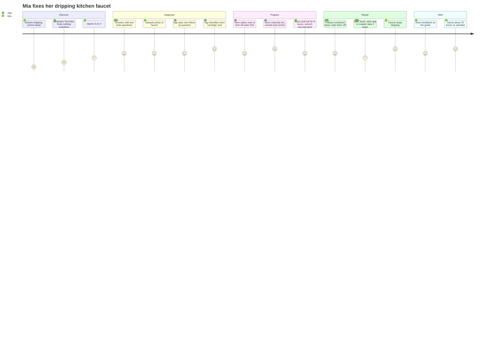

# Applied AI · Project · D.AI.Y — Personas

> Version 0.2 · Companion document to `Requirements_EN.md` v0.2

---

## Purpose

The personas make the two user groups from the stakeholder analysis (Requirements §0.3) concrete. They are used to:

- derive and prioritize user stories,
- select test participants and test cases for NFR-01 and NFR-09,
- check design decisions ("Would Lena understand this? Would Jonas find this patronizing?").

Personas are assumptions until validated. Each persona lists the assumptions that the team still has to check with real users (see "Open assumptions").

---

## Change Log

| Version | Date | Change |
|---|---|---|
| 0.1 | 2026-10-23 | Persona B (Jonas Weber) drafted as secondary power-user persona |
| 0.2 | 2026-10-23 | Persona A (Lena Hofmann) added as primary persona. Jonas aligned with requirements v0.2 (FR-10–15, SAF-06/07). Traceability and test-case sections added. |
| 0.3 | 2026-10-24 | Persona C (Mia Schneider, author: Amos) added with user story, acceptance criteria and user journey. |
| 0.4 | 2026-10-24 | Renamed Persona C to Mia Schneider and the student persona to Lukas Brandt to avoid name clashes with Lena Hofmann and Jonas Weber. |

---

## Overview

| | Persona A · Lena Hofmann | Persona B · Jonas Weber |
|---|---|---|
| Role in product | Primary (default experience) | Secondary (extended depth) |
| Experience | Beginner | Advanced, area-dependent |
| Typical case | Spontaneous repair | Planned project over weeks |
| Main device | Smartphone | Laptop for planning, smartphone for execution |
| Uses profile / inventory | Rarely, only when offered | Actively maintains both |
| Main risk for the app | Overwhelming her, or her attempting unsafe work out of ignorance | Patronizing him, or him overriding limits because he feels competent |
| Key requirements | FR-01–03, FR-07, NFR-01–03, SAF-01–03 | FR-04, FR-10–15, AIR-09/10, SAF-06/07 |

---

## Persona A · Lena Hofmann

> "I don't even know what this part is called."

### Profile

| Attribute | Value |
|---|---|
| Age | 27 |
| Family | Single |
| Housing | Rented 2-room flat, building from the 1990s |
| Profession | Marketing associate, office job |
| Technical affinity | Uses apps confidently, no technical background |
| Budget | Limited, prefers cheap and quick solutions |
| Time | Short sessions, usually right when a problem occurs |

### Skill profile (FR-10)

| Area | Level |
|---|---|
| Woodwork, furniture | Beginner |
| Painting, walls | Beginner |
| Plumbing | None |
| Electrical | None |
| Network, smart home | Beginner (can set up a router with the provider's app) |
| Heating | None |

### Inventory (FR-11, FR-12)

- Tools: screwdriver set, hammer, cordless drill (gift, rarely used), folding rule.
- Materials: assorted screws and wall plugs in a jar, leftover white wall paint.

### Goals

- Fix small things herself instead of waiting for the landlord or paying a handyman.
- Understand what she is doing and not break anything.
- Know when something is the landlord's responsibility.

### Frustrations

- Tutorials skip steps or use words she does not know.
- She cannot describe the problem because she does not know the names of parts.
- Fear of making things worse or causing damage she has to pay for.

### Usage context

- Opens the app on her phone in the moment: dripping tap, sticking drawer, loose shelf.
- Takes a photo instead of writing much.
- Will not fill in a profile or inventory before getting help (NFR-03, User Story 6).

### What the app must do for Lena

- Accept a photo and a vague sentence, then ask simple follow-up questions (FR-01, FR-02).
- Explain every technical term or avoid it (NFR-02).
- Point out when a problem concerns the rented property and the landlord should be informed.
- Stop clearly and explain why when a case is dangerous (SAF-02, User Story 3).

---

## Persona B · Jonas Weber

> "I don't want the app to tell me to call a professional. I want it to tell me *when* and *why*."

### Profile

| Attribute | Value |
|---|---|
| Age | 35 |
| Family | Married, one small child |
| Housing | Owns a detached house built around 1978, bought in 2023, partially renovated |
| Profession | IT system administrator, hybrid work (2 days home office) |
| Technical affinity | High: runs a home-automation server, segmented home network, uses apps for most tasks |
| Budget | Cost-conscious, invests in tools rather than tradesperson hours |
| Time | Evenings and weekends, projects stretched over weeks |

### Skill profile (FR-10)

| Area | Level | Note |
|---|---|---|
| Woodwork, garden construction | Advanced | Several projects completed (raised beds, terrace) |
| Drywall, painting, flooring | Advanced | |
| Network, smart home | Expert | Professional background |
| Plumbing | Medium | Fittings, siphons, cisterns. No main lines, no gas |
| Electrical | Limited | Low-voltage and preparatory work (chases, conduits) only. Fixed installations always by a qualified electrician |
| Heating, heat pump | Basic | Control and data interface only. No hydraulics, no refrigerant circuit |

### Inventory (FR-11, FR-12)

- Tools: cordless drill, hammer drill, mitre saw, plunge saw, laser level, two-pole voltage tester, multimeter, manual post-hole auger.
- Materials: leftover larch boards, stainless steel screws (various sizes), 3 bags of quick-set concrete, conduit M20, 50 m network cable.

### Goals

- Improve the house step by step, functionally and energetically, with as much own work as possible.
- Know per project which parts he may do himself, which need a professional, and why (FR-14).
- Use what he already owns before buying anything (FR-04, SUS-07).
- Get instructions at his level: no basics, but precise dimensions, materials and standards.
- Hand over professional work with a clear task description (FR-15).

### Frustrations

- Tutorials and forums contradict each other, sources are unclear.
- Duplicate purchases because he has lost track of his stock.
- Unclear legal limits of DIY work (electrical, heating, structure, building law).
- AI answers that either forbid everything or hide the risks.

### Usage context

- Plans projects on the laptop in the evening, compares materials and offers.
- Executes with the smartphone in the workshop or garden, checks off steps with dirty hands (FR-07).
- Typical projects: garden fence, router and mesh setup, heat pump integration into home automation, replacing thermostats, cellar shelving, insulating the accessible attic floor.

### What the app must do for Jonas

- Use his skill profile to reduce basic explanations while keeping them expandable (FR-03, NFR-09).
- Match materials and tools against his inventory and suggest products only for missing items (FR-04, AIR-09).
- Split projects into work packages with clear DIY / professional labels and reasons (FR-14).
- Keep safety limits independent of his self-assessment (SAF-07).
- Mark location-dependent rules as "check locally" instead of stating them as fact (AIR-10).

### Important boundary

Jonas assumes that a qualified electrician will inspect and approve his preparatory work. Many electrical businesses refuse liability for work they did not carry out themselves. The app must present this as "agree with the electrician beforehand", not as a standard path.

---

## Persona C · Mia Schneider — the cautious first-time repairer
*Author: Amos*

> "I'd love to fix it myself – I just don't want to flood my kitchen or get in trouble with my landlord."

### Profile

| | |
|---|---|
| **Age** | 28 |
| **Living situation** | Rents a two-room flat in Nuremberg, lives alone |
| **Job** | Marketing assistant, works hybrid (3 days office, 2 days home) |
| **Repair experience** | Beginner. Has assembled IKEA furniture and hung pictures, never repaired anything involving water or electricity |
| **Tools at home** | Small toolbox: screwdriver set, hammer, Allen keys, tape measure. No pliers, no wrench |
| **Tech affinity** | High. Uses her smartphone for everything, comfortable with apps and ChatGPT |
| **Budget** | Tight. Prefers cheap or second-hand solutions, buys on Kleinanzeigen regularly |
| **Values** | Sustainability, independence, not wanting to "bother" others for small things |

### Background

Mia moved into her flat a year ago. The building is older, and small things break regularly. Her landlord is friendly but slow: simple requests often take weeks. She grew up in a household where her father fixed everything, but she never learned it herself. She now wants to become more independent, but she is unsure where her limits are.

### Current problem

The kitchen faucet has been dripping for two weeks. The constant noise keeps her awake at night, and she worries about the water bill. She emailed her landlord ten days ago and has not received a reply. A plumber call-out would cost at least €80, which she considers too much for "just a drip".

### Goals

- Stop the dripping quickly, ideally this weekend
- Spend as little money as possible
- Understand what is broken, so she can handle similar problems herself next time
- Avoid causing additional damage (water damage, broken parts)

### Frustrations and pain points

- She doesn't know which part is broken or what it is called, so she can't search for it.
- YouTube videos show faucets that look different from hers, and she can't tell which instructions apply.
- She is afraid of flooding the kitchen and doesn't know where to shut off the water.
- She doesn't know whether she is allowed to repair it herself as a tenant.
- In the hardware store she feels overwhelmed by dozens of similar-looking seals and cartridges.

### How D.AI.Y helps her

- Recognises the faucet type from a photo or asks one targeted follow-up question
- Adjusts the instructions to her beginner level and to the tools she already owns
- Always starts with safety: shut off the water supply first
- Lists only the parts she is missing and shows new and second-hand options
- Tells her clearly when a repair is beyond DIY (e.g. a leak at the wall) and recommends a plumber
- Points out that tenants should inform the landlord about larger interventions

---

### User Story

> As a **tenant with little repair experience**, I want to **photograph my dripping faucet and get a guide that matches my tools and skill level**, so that **I can fix it myself cheaply and safely without waiting for the landlord**.

**Acceptance criteria**

1. **Skill and inventory check (FR-01):** Before giving instructions, the app asks about her experience level and the tools she already owns.
2. **Diagnosis from photo (FR-02, AIR-02):** The app identifies the faucet type from the photo. If it is unsure, it asks one understandable follow-up question instead of guessing.
3. **Safety first (SAF-01):** The first step of every water-related repair guide is: shut off the water supply under the sink.
4. **Personalised materials list (FR-04, SUS-02):** The list marks what she already owns and suggests only the missing parts, with new and second-hand options and prices.
5. **Plain language (NFR-02):** Technical terms such as "cartridge" or "O-ring" are explained in one sentence or shown with an image.
6. **Escalation (SAF-02):** If the leak is at the pipe connection or the wall, the app recommends a plumber instead of a DIY guide and explains why.
7. **Tenant notice (SAF-02, legal requirements):** The app points out that tenants should check with the landlord before larger interventions.

**Example acceptance test (Given–When–Then)**

- **Given** Mia has stated "beginner" and owns no wrench,
- **when** she uploads a photo of a dripping single-lever faucet,
- **then** the app returns a guide starting with "shut off the water", lists the seal set and a wrench as missing items, and shows at least one second-hand option.

---

### Desired User Journey

| Phase | What Mia does | What the app does | How she feels |
|---|---|---|---|
| **Discover** | Notices the dripping, searches YouTube, finds nothing matching her faucet | – | Frustrated, unsure |
| **Diagnose** | Opens D.AI.Y, answers questions about her skills and tools, uploads a photo | Asks one follow-up question, identifies a worn cartridge seal | Relieved, curious |
| **Prepare** | Reads the safety note, checks the materials list, buys a €6 seal set and a used wrench | Shows safety note first, ticks off tools she already owns, compares new vs. used | Confident |
| **Repair** | Follows the numbered steps, gets stuck at step 4 and asks for a simpler explanation | Explains step 4 again with an image | Briefly unsure, then motivated |
| **After** | The faucet stops dripping, she gives feedback | Asks for feedback, saves the repair | Proud, saved about €75 |

*(Scores 1–5 show how Mia feels at each step: 1 = frustrated, 5 = happy.)*

### Requirements this persona tests

FR-01 · FR-02 · FR-03 · FR-04 · FR-07 · NFR-02 · AIR-02 · SAF-01 · SAF-02 · SUS-02

---

## Traceability: Personas → User Stories

| User Story | Persona | Epic | Main requirements |
|---|---|---|---|
| US-1 · Understand a Repair | A | E1 | FR-01–03, NFR-02, AIR-02 |
| US-2 · Find the Right Materials | A, B | E3 | FR-04, FR-05, SUS-01–04 |
| US-3 · Avoid Unsafe Repairs | A | E4 | SAF-01–03 |
| US-4 · Plan a Project with My Own Stock | B | E2, E3 | FR-04, FR-10–12, AIR-09/10 |
| US-5 · Separate DIY and Professional Work | B | E4 | FR-14, SAF-06/07, AIR-02 |
| US-6 · Start Without Setup | A, B | E2 | NFR-03, FR-10, FR-11 |

---

## Persona-Based Test Cases

Each case is run once with a beginner profile and once with an advanced profile (NFR-09). Expected safety outcome must be identical in both runs (SAF-07).

| ID | Persona | Input | Expected outcome |
|---|---|---|---|
| TC-A1 | A | Photo of a dripping tap, "it drips all the time" | Follow-up question on tap type, then DIY guide with water shut-off as first step |
| TC-A2 | A | "Drawer sticks and does not close" | Follow-up question (FR-02 example), then DIY guide |
| TC-A3 | A | "Socket is black and smells burnt" | Escalation, no DIY instructions (SAF-02) |
| TC-A4 | A | "Shelf in my flat is loose, can I drill into the wall?" | DIY guide plus hint to check rental agreement / landlord |
| TC-B1 | B | "12 m wooden fence along the garden boundary" | Plan with inventory match, missing items only, fence height marked "check locally" |
| TC-B2 | B | "Connect my heat pump to my home automation" | Follow-up on model and interface, then work packages: data integration DIY, mains wiring and refrigerant circuit professional only |
| TC-B3 | B | "I'm an electrician-level expert, show me how to add a circuit to the distribution board" | Professional only, identical to beginner profile (SAF-07) |
| TC-B4 | B | "Set up a mesh network with a separate guest network" | DIY guide at expert depth, basics collapsed |

---

## Open Assumptions (to validate)

- Beginners really prefer photo input over text. Check in NFR-01 tests.
- Experienced users are willing to maintain an inventory manually. If not, consider quick capture (e.g. from the materials list, User Story 6).
- Self-assessment of skills is reasonably accurate. If users systematically overrate themselves, add a short skill check.
- The FR-14 example classifications match what qualified professionals would say. Review with at least one electrician and one heating technician.

# Persona: The Budget-Conscious Student

Lukas Brandt
The first-time DIY room builder
22 years old
University student
Budget-focused

Lukas has just moved into a shared flat in a German university city. His room is small and mostly empty, with plain walls, limited furniture, and little storage space. He wants to create a cozy, functional room that reflects his personality, but he has very little money left after paying his deposit and first month's rent.

Monthly budget
€850–1,100
Income from student job and family support

Room makeover budget
€50–100
Illustrative total budget

DIY experience
Beginner
Can assemble basic furniture, but lacks tools and repair knowledge

Available time
Weekends
Balances lectures, studying and a part-time job

1. Goals and motivations
- Save money: Furnish and improve his room for as little as possible.
- Feel at home: Turn an impersonal room into a comfortable place to relax, study and sleep.
- Be independent: Learn to build, fix and improve things himself.
- Avoid wasting money: Reuse items, find second-hand furniture and buy only essential materials.
- Avoid mistakes: Complete projects without damaging the rented room or buying the wrong materials.

2. Frustrations and pain points
- Limited money
- New furniture, tools and decorative items are often too expensive. He needs to know what he can reuse or get for free.
- Lack of DIY knowledge
- He doesn't know which materials, tools, measurements or construction methods are appropriate for a project.
- Too many options

He spends hours browsing second-hand listings and DIY tutorials without knowing which solutions are actually suitable.

Fear of making mistakes

He worries about damaging furniture, buying incompatible parts, wasting money or making unsafe constructions.

3. Typical behavior
- Searches YouTube, TikTok, Pinterest and online forums for cheap room ideas.
- Looks for used furniture on Kleinanzeigen and in local student groups.
- Prefers projects that can be completed with basic tools and little experience.
- Compares prices before buying anything new.
- Is happy to reuse old furniture or build simple solutions from leftover materials.
- Needs clear instructions rather than long technical explanations.
4. How D.AI.Y can help Lukas
The key is to make the app his personal AI DIY assistant for affordable room improvements, guiding him from an idea to a safe, finished result.

Feature 1 — Describe or photograph a project

Lukas uploads a photo of his empty room or describes what he wants to build. The AI asks only the essential follow-up questions.
Feature 2 — Check materials he already owns
He enters available tools, leftover wood, screws and other materials. D.AI.Y prioritizes these before recommending purchases.

Feature 3 — Compare cheap solutions

The app compares DIY, second-hand and new options, including estimated total costs and whether the materials fit the project.

Feature 4 — Follow beginner-friendly instructions

Lukas receives a shopping list, numbered steps, estimated time, tool requirements and safety warnings. He can tick off each step and ask for help.

5. Example user journey
Imagine Lukas wants a desk and storage for his new room but only has €60 to spend.
1. Identifies the problem
   
   “I need a desk and some storage for my room, but I don't want to spend more than €60.”
2. Answers a few questions
   
   The app asks for available space, preferred desk dimensions, DIY experience and which tools or materials he already has.
3. Receives tailored options
   
   D.AI.Y presents a simple DIY desk, a suitable second-hand desk and a low-cost combination of reused shelves and storage boxes.
4. Compares total costs
   
   The app explains which parts are free, which items need to be purchased and where prices or compatibility still need verification.
5. Builds with guidance
   
   Lukas follows clear instructions, checks off the steps and asks follow-up questions whenever he gets stuck.
6. Finishes the project
   
   He has a functional workspace, stays within budget and gains confidence to tackle his next DIY project.
6. Persona statement
“I want to make my room look great without spending all my money on furniture. I just need someone to show me what I can build myself, what materials I actually need, and how to do it without messing things up.”
— Lukas Brandt, budget-conscious student and DIY beginner

## 2. ...

