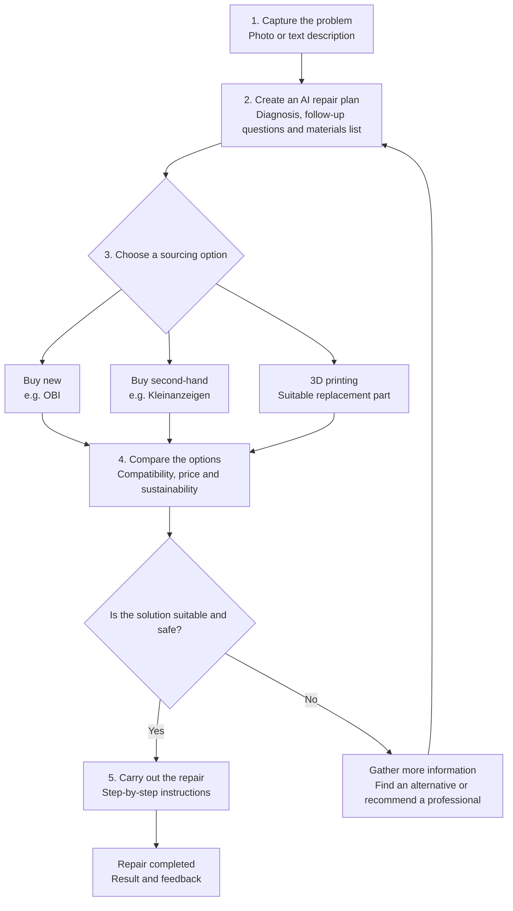

# Applied AI · Project · D.AI.Y

An AI-powered DIY platform that helps people repair household items safely and confidently, even without technical expertise.

## Overview

Applied AI · D.AI.Y supports users through the full repair journey:
- describe a problem in everyday language
- upload a photo or provide a text description
- receive follow-up questions when important details are missing
- get structured, step-by-step repair instructions
- compare suitable new and second-hand alternatives
- identify unsafe or high-risk repair cases before suggesting solutions

The goal is not just to generate a repair guide, but to provide safe, understandable, and actionable guidance based on the user’s actual situation.

---

## Concept Flow

---

## Why this project matters

Many people face common household repair problems such as sticking drawers, broken handles, damaged hinges, or worn-out components. Often, they do not know:
- what the actual problem is
- which tools or materials are needed
- whether a repair is safe
- whether a second-hand or replacement part is a better option

This project aims to provide an accessible, guided, and safety-conscious repair assistant that helps non-experts make confident decisions.

---

## Core Features

### 1. User skill assessment & Problem input
App asks users about their knowledge and skills in certain areas to adjust its answers accordinlgy. In addition, app checks for existing inventory. If user is electrician, app gives more expert support on electrical installations, but might give more junior instructions on car repairs. 
Users can describe a repair issue in plain language and optionally upload a photo.

### 2. Interactive diagnosis
If the problem is unclear, the AI asks targeted follow-up questions instead of making assumptions.

### 3. Step-by-step repair instructions
The app provides easy-to-follow instructions with:
- required tools
- materials
- estimated time
- warnings
- safety notes

### 4. Materials and product suggestions
The system creates a bill of materials and suggests:
- new products
- second-hand alternatives
- compatible replacement parts

### 5. Sustainability awareness
The app prioritizes repair and reuse options and compares product choices based on:
- price
- condition
- compatibility
- sustainability impact

### 6. Safety and risk detection
Before providing instructions, the app checks whether the case involves danger, unclear conditions, or potentially unsafe repair scenarios.

### 7. Guided repair assistance
Users can:
- mark steps as complete
- request repeat explanations
- ask follow-up questions during the process

---

## MVP Scope

The initial version focuses on the most important user value:

- Free-text problem input
- Follow-up questions for missing information
- Structured repair instructions
- Materials list and sample product suggestions
- Safety checks and escalation for risky scenarios
- Simple, understandable user guidance

This follows a MoSCoW-style prioritization:
- Must-have: diagnose and guide repair
- Should-have: compare new and second-hand options
- Could-have: 3D print suggestions
- Not in MVP: in-app purchasing, user accounts, long-term project history

## Non-Functional Requirements

The project aims to deliver a product that is:
- easy to use for non-experts
- understandable in plain language
- low-complexity and fast to start
- reliable in results and validation
- protective of user data
- accessible and readable
- maintainable through versioned prompts and test cases

---

## AI Requirements

The AI should not simply provide the most detailed answer possible. It should generate useful, structured, and verifiable repair support.

The system should:
- summarize the problem clearly
- ask for missing information when needed
- return consistent, structured output
- account for the user’s skill level
- evaluate products against practical requirements
- clearly separate verified information from AI estimates
- handle errors and uncertainty transparently

---

## Safety Requirements

Because users are repairing real objects, bad guidance can lead to injuries, property damage, or unsafe construction.

The app should:
- detect risk signals before presenting instructions
- avoid providing improvised repair advice in hazardous situations
- validate AI output structure and completeness
- avoid recommending unsafe 3D-printed parts for safety-critical uses
- not claim compatibility or quality without sufficient evidence

---

## Sustainability and Marketplace Support

The project differs from a conventional chatbot by considering sustainable repair and sourcing options.

It should:
- promote second-hand alternatives where suitable
- compare new and used options transparently
- explain sustainability reasoning without unsupported claims
- show product availability and data freshness clearly
- link users to retailers or sellers for purchase

---

## Project Status

This repository is currently in an early project stage and focuses on defining the concept, requirements, and product direction.

Planned next steps:
- define the architecture and system components
- prototype the user workflow
- implement the AI repair diagnosis flow
- validate safety and reliability requirements
- build the first end-to-end MVP

---

## License

This project does not yet specify a license. Add a license file and update this section once the project direction is finalized.

---

## Contributing

This project is still in the planning and prototyping phase. Contributions are welcome once the MVP scope and architecture are defined.

If you want to contribute, start by reviewing the project requirements and suggesting improvements to the user experience, AI logic, safety checks, or repair workflow.
