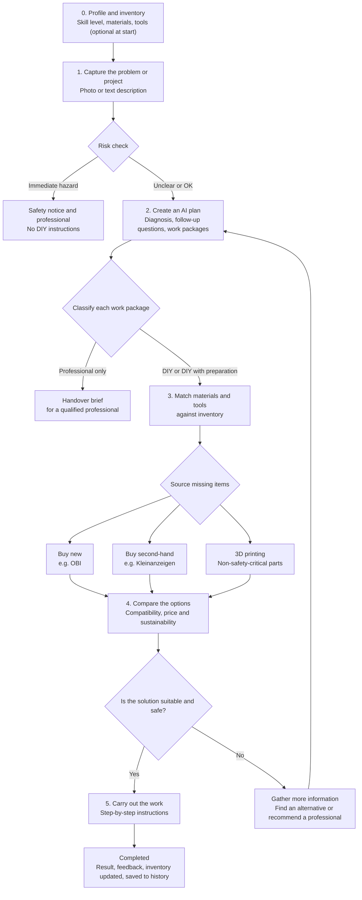

# Applied AI · Project · D.AI.Y

An AI-powered DIY platform that helps people, regardless of their technical skills, safely repair household items and carry out small home projects themselves.

> This README is a summary. The binding source is [`Requirements_EN.md`](Requirements_EN.md) (v0.2). Full personas, traceability and test cases: [`Personas_EN.md`](Personas_EN.md).

## Overview

Applied AI · D.AI.Y supports users through the full repair or project journey:
- describe a problem or project in everyday language
- upload a photo or provide a text description
- receive follow-up questions when important details are missing
- see which work packages are DIY and which need a qualified professional
- get structured, step-by-step instructions adapted to their skill level
- reuse materials and tools they already own before buying anything
- compare suitable new and second-hand alternatives for missing items
- identify unsafe or high-risk cases before any instructions are given

The goal is not just to generate a guide, but to provide safe, understandable, and actionable guidance based on the user's actual situation, skills, and inventory.

---

## Concept Flow

---

## Why this project matters

Many people face common household repairs or small home projects such as sticking drawers, loose shelves, a garden fence, or a smart-home integration. Often, they do not know:
- what the actual problem is
- which tools or materials are needed, and which they already own
- whether the work is safe and whether they are allowed to do it themselves
- whether a second-hand or replacement part is a better option

This project aims to provide an accessible, guided, and safety-conscious assistant that helps both beginners and experienced DIYers make confident decisions.

---

## Target Users

| Persona | Role in product | Needs |
|---|---|---|
| **A · Lena Hofmann**, 27, rents a flat, beginner | Primary (default experience) | Simple language, photo input, clear stop when something is dangerous |
| **B · Jonas Weber**, 35, homeowner, advanced DIYer | Secondary (extended depth) | Inventory, skill-based depth, clear DIY vs. professional split with reasons |

Both personas use the same flow. A higher skill level changes detail and language, never the safety limits.

---

## Core Features

### 1. Skill profile and inventory
Users can optionally state their experience per area (e.g. woodwork, plumbing, electrical, network, heating) and record the materials and tools they own. Without a profile, the app assumes "beginner". Profile and inventory never block the start of a case.

### 2. Problem and project input
Users describe a repair issue or a small project in plain language and optionally upload a photo.

### 3. Interactive diagnosis
If the problem is unclear, the AI asks targeted follow-up questions instead of making assumptions.

### 4. Work-package classification
Projects are split into work packages, each labelled **DIY**, **DIY preparation for a professional**, **professional only**, or **not recommended**, with a short reason. Uncertain cases get the stricter label.

### 5. Step-by-step instructions
Easy-to-follow instructions with required tools, materials, estimated time, warnings, and safety notes. Basic steps are collapsed for experienced users but always expandable.

### 6. Materials and product suggestions
The system creates a bill of materials, matches it against the user's inventory, and suggests new and second-hand products only for missing items.

### 7. Sustainability awareness
The app prioritizes repair and reuse and compares options by price, condition, compatibility, and sustainability impact.

### 8. Safety and risk detection
Before providing instructions, the app checks whether the case involves danger, unclear conditions, or work reserved for qualified professionals.

### 9. Guided execution
Users can mark steps as complete, request repeat or simpler explanations, and ask follow-up questions during the work.

---

## Scope

**In scope:** repairs of household items and fixtures, small home and garden projects, low-voltage and digital projects (e.g. router, smart home, heat-pump data interface), and planning support that splits a project into DIY and professional work.

**Out of scope** (the app informs and escalates, but gives no instructions): fixed 230/400 V installations, gas, refrigerant circuits, load-bearing structures, chimneys, full energy-renovation planning, and in-app purchasing.

---

## MVP Prioritization (MoSCoW)

- **Must:** problem and project input, follow-up questions, structured instructions, materials list matched against inventory (sample product data), guided execution, local skill profile, local material inventory, work-package classification, risk detection and escalation
- **Should:** real retailer and second-hand search, user accounts and sync, tool inventory, project history
- **Could:** 3D model library, handover brief for professionals
- **Won't:** in-app purchasing

---

## Non-Functional Requirements

The project aims to deliver a product that is:
- easy to use for non-experts, tested with both persona groups
- understandable in plain language
- low-complexity and fast to start (no more than 3 required input steps)
- adaptive in depth while keeping safety content identical across skill levels
- reliable in results and validation
- protective of user data
- accessible and readable
- maintainable through versioned prompts and test cases

---

## AI Requirements

The AI should not simply provide the most detailed answer possible. It should generate useful, structured, and verifiable support.

The system should:
- summarize the problem clearly
- ask for missing information when needed
- return consistent, structured output
- account for the user's skill level
- only mark items as available if they are in the inventory in sufficient quantity
- mark location-dependent rules (e.g. fence height, permits) as "check locally"
- evaluate products against practical requirements
- clearly separate verified information from AI estimates
- handle errors and uncertainty transparently

---

## Safety Requirements

Because users work on real objects, bad guidance can lead to injuries, property damage, or unsafe construction.

The app should:
- detect risk signals before presenting instructions
- avoid providing improvised advice in hazardous situations
- choose the more restrictive classification when a work package is uncertain
- never unlock restricted work because of a high self-assessed skill level
- validate AI output structure and completeness
- avoid recommending unsafe 3D-printed parts for safety-critical uses
- not claim compatibility or quality without sufficient evidence

---

## Sustainability and Marketplace Support

The project differs from a conventional chatbot by considering sustainable repair and sourcing options.

It should:
- propose matching items from the user's own inventory before any purchase
- promote second-hand alternatives where suitable
- compare new and used options transparently
- explain sustainability reasoning without unsupported claims
- show product availability and data freshness clearly
- link users to retailers or sellers for purchase

---

## Project Status

This repository is in an early project stage. Requirements v0.2 and personas v0.2 are drafted for team review.

Planned next steps:
- validate open questions and persona assumptions (see the end of each document)
- define the evaluation set of test cases, including high-risk cases
- define the architecture and system components
- prototype the user workflow
- implement the AI diagnosis and work-package classification flow
- build the first end-to-end MVP

Sprints, testing and schedule up to 04.11: [Implementation_Plan_EN.md](Implementation_Plan_EN.md).

---

## Repository Contents

| File | Content |
|---|---|
| [`Requirements_EN.md`](Requirements_EN.md) | Requirements v0.2: scope, stakeholders, FR/NFR/AIR/SAF/SUS, MoSCoW, epics, user stories |
| [`Personas_EN.md`](Personas_EN.md) | Personas v0.2: full profiles, traceability, persona-based test cases |

---

## License

This project does not yet specify a license. Add a license file and update this section once the project direction is finalized.

---

## Contributing

This project is still in the planning and prototyping phase. Contributions are welcome once the MVP scope and architecture are defined.

If you want to contribute, start by reviewing the requirements and personas and suggesting improvements to the user experience, AI logic, safety checks, or workflow.
