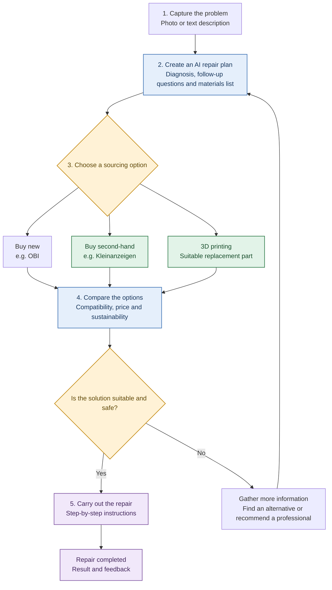

# Applied AI · Project · D.AI.Y

> **Project requirements and concept overview**

---

## Concept Flow

---

## Requirements

### 1. Product Requirements — What should the app do?

As a starting point, you can use the following product vision:

> An AI-powered DIY platform that helps people, regardless of their technical skills, safely repair household items themselves, find suitable materials, and use sustainable sourcing or manufacturing options.

### 2. Functional Requirements

These are the specific functions the system should provide.

#### FR-01 · Problem Input

Users can describe a repair problem in plain language and optionally upload a photo.

**Priority:** MVP — Must-have

*Example:* “My drawer is sticking and no longer closes properly.”

#### FR-02 · Interactive Problem Diagnosis

The AI asks targeted follow-up questions when information needed to find a suitable solution is missing.

**Priority:** MVP — Must-have

*Example:* “Does the drawer stick when you pull it out, or only when you close it?”

#### FR-03 · Step-by-Step Repair Instructions

The app provides easy-to-understand instructions, including the required tools and materials, estimated time, and warnings.

**Priority:** MVP — Must-have

#### FR-04 · Product Search and Materials List

The app creates a bill of materials from the instructions and suggests suitable new products as well as second-hand alternatives.
The app also offers a material stock list where the user can input the current available stocks in the user's posession. 

**Priority:** MVP — using sample data

Real retailer and classifieds integrations can be added later.

#### FR-05 · Sustainable Alternatives

The app prioritizes suitable repair and reuse options and transparently compares new and second-hand offers.

**Priority:** Enhancement

#### FR-06 · 3D Printing Option

For suitable, non-safety-critical replacement parts, the app can suggest matching 3D models and link to a download or printing service.

**Priority:** Later development stage

#### FR-07 · Repair Guidance

Users can check off individual steps, ask for a step to be explained again, and ask follow-up questions when they encounter a problem.

**Priority:** MVP — Must-have

---

### 3. Non-Functional Requirements — Quality Requirements

These requirements describe how well the app must work. They are particularly important for your target audience.

| ID | Requirement | Measurable acceptance criterion for the prototype |
|---|---|---|
| NFR-01 | Ease of use | At least 4 out of 5 test participants can start a repair case without help. |
| NFR-02 | Understandable language | Instructions avoid unnecessary jargon or explain technical terms directly. |
| NFR-03 | Low complexity | A user can start a test case in no more than 3 required input steps. |
| NFR-04 | Performance | For normal test cases, the AI response appears within an agreed target, e.g. 10 seconds at the 95th percentile. |
| NFR-05 | Reliability | Incorrect or incomplete AI outputs are detected and are not displayed without validation. |
| NFR-06 | Data protection | Users are informed how their text and photos are processed; unnecessary personal data is not collected. |
| NFR-07 | Accessible use | Adequate contrast, readable text, clear labels, and usability without relying on color alone. |
| NFR-08 | Maintainability | Prompts, test cases, and changes are versioned and documented in a traceable way. |

These values are proposed project targets, not properties of your app that have already been demonstrated. Your team should agree on them and then test them.

For your target audience, I would pay particular attention to these UX principles:

- Users should not need to know how to write a good prompt.
- The app asks for missing information in everyday language.
- Instructions use short sentences, numbered steps, and illustrative images where available.
- Users can go back at any time or ask for an explanation to be simplified.
- The app always provides understandable feedback when the AI does not know something or the app encounters an error.

---

### 4. AI Requirements — Requirements for Artificial Intelligence

This is the core of your Applied AI project. The AI should not simply provide the most detailed answer possible; it should generate useful and verifiable repair suggestions.

| ID | Requirement | Acceptance criterion |
|---|---|---|
| AIR-01 | Problem understanding | The AI summarizes the described problem in a way the user can understand and follow. |
| AIR-02 | Handling uncertainty | When important information is missing, the AI asks follow-up questions instead of presenting assumptions as facts. |
| AIR-03 | Structured output | Every standard set of instructions includes a diagnosis, tools, materials, steps, and warnings. |
| AIR-04 | Personalization | The AI takes the user's stated experience level into account. |
| AIR-05 | Product matching | Product recommendations are evaluated against concrete requirements such as dimensions, material, and function. |
| AIR-06 | Source and data transparency | The app distinguishes verified product data, AI estimates, and unverified information. |
| AIR-07 | Error handling | When information is insufficient or a technical error occurs, the app displays an understandable notice instead of inventing a solution. |
| AIR-08 | Consistency | Repeated tests using the same cases are evaluated, and relevant variations are documented. |

A key design principle: the AI must not automatically turn every request into a repair guide. Sometimes the right response is to ask for more information first or advise against attempting the repair.

---

### 5. Safety Requirements — Safety and Trust

Because users are repairing real objects, incorrect recommendations can lead to injuries, property damage, or unsafe constructions.

I would therefore define dedicated safety requirements rather than treating safety merely as part of general AI quality.

#### SAF-01 · Risk Classification

Every case is checked for recognizable risk signals before instructions are provided. When a case is unclear, the app takes a conservative approach.

#### SAF-02 · Dangerous Repairs & Legal Requirements

In cases involving a gas smell, damaged electrical wiring, or other immediate hazards, the app does not provide an improvised repair guide. Instead, it directs users to appropriate safety measures and qualified professionals. Repairs shall be subject to legal requirements and industry standards. 

#### SAF-03 · Validation

The app checks whether the AI output is complete, follows the expected format, and triggers no prohibited or risky output paths.

#### SAF-04 · Safe 3D Printing Suggestions

Printed parts are not recommended for safety-critical applications without professional review. A 3D model that looks similar is not proof of mechanical suitability.

#### SAF-05 · Reliable Product Information

The app must not claim that a second-hand product is compatible, available, or of a particular quality unless there is sufficient evidence for that information.

For evaluation, you can distinguish three outcomes: **safe recommendation**, **appropriate follow-up question or escalation**, and **unsafe recommendation**. The last category should be treated as a critical failure.

---

### 6. Sustainability & Marketplace Requirements

These requirements distinguish your app from a conventional AI chatbot or a traditional shopping app.

| ID | Requirement | Acceptance criterion |
|---|---|---|
| SUS-01 | Consider the second-hand market | Where suitable data is available, the app offers second-hand alternatives. |
| SUS-02 | Comparability | New and second-hand offers are presented in a comparable way based on price, condition, dimensions, and compatibility. |
| SUS-03 | Transparent sustainability | The app explains why an alternative may be more sustainable without claiming unsupported CO₂ savings. |
| SUS-04 | Product availability | The availability and freshness of offer data are clearly indicated. |
| SUS-05 | Direct purchase | Users can go to the retailer or seller; purchasing within the app is a later enhancement. |
| SUS-06 | 3D printing | Suitable models are linked with dimensions, material requirements, licensing information, and intended use. |

For external marketplaces, you should also distinguish between product research, redirecting users to make a purchase, and completing a transaction inside your app. The latter introduces significantly more requirements relating to payment processing, data protection, seller terms, and support.

---

### 7. Which Requirements Really Belong in Your MVP?

For the presentation, I would not treat all requirements as equally important. Use **MoSCoW prioritization**.

| ID | Requirement | Priority |
|---|---|---|
| FR-01 | Enter the problem in everyday language | **Must-have** |
| FR-02 | Ask follow-up questions for unclear cases | **Must-have** |
| FR-03 | Structured repair instructions | **Must-have** |
| FR-04 | Materials list and sample products | **Must-have** |
| FR-07 | Check off steps and ask follow-up questions | **Must-have** |
| SAF-01 | Detect risks and escalate | **Must-have** |
| AIR-03 | Structured output format | **Must-have** |
| NFR-01 | Test usability with non-experts | **Must-have** |
| FR-05 | Real retailer and second-hand marketplace search | **Should-have** |
| FR-06 | 3D model library | **Could-have** |
| FR-08 | User accounts and project history | **Not in the MVP** |
| FR-09 | Purchasing directly within the app | **Not in the MVP** |

---

## User Stories

### User Story 1 · Understand a Repair

As a user with limited technical experience, I want to describe my household problem in simple words so that I can get a suitable guide without needing specialist knowledge.

**Acceptance criteria**

- The input accepts a free-text description.
- When important information is missing, the app asks understandable follow-up questions.
- The instructions include tools, materials, numbered steps, and safety warnings.
- Technical terms are explained or avoided.

### User Story 2 · Find the Right Materials

As a budget-conscious user, I want to compare suitable new and second-hand products so that I can carry out the repair affordably and as sustainably as possible.

**Acceptance criteria**

- The app creates a materials list from the repair instructions.
- Product suggestions are filtered according to defined requirements.
- Price, condition, and data source are displayed transparently.
- Unverified compatibility is marked as uncertain.

### User Story 3 · Avoid Unsafe Repairs

As a user without hands-on repair experience, I want to be warned when a repair could be dangerous so that I do not put myself or others at risk.

**Acceptance criteria**

- Defined high-risk test cases trigger the intended warning or escalation.
- No disallowed DIY instructions are provided for these cases.
- The app clearly explains why it is not providing repair instructions.
- Unclear cases are not automatically classified as safe.
