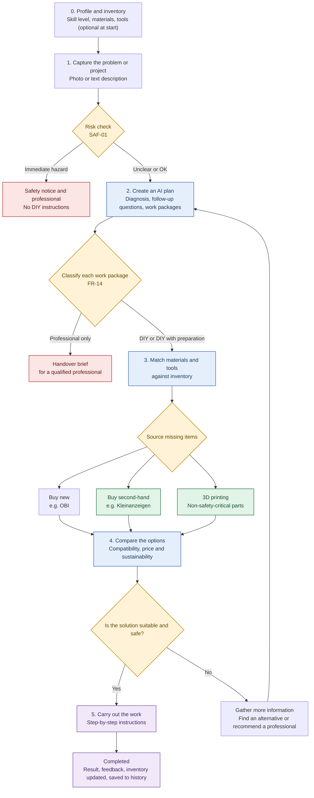

# Applied AI · Project · D.AI.Y

> **Project requirements and concept overview** · Version 0.4 (draft for team review)
>
> **Status:** input for Agent M, registered as a source. The binding requirements are produced in Agent M from this document, the personas and the prototype (see the [implementation plan](Implementation_Plan_EN.md)). Once those are accepted, this document is frozen as source version 0.4.

---

## Change Log

| Version | Date | Change | Rationale |
|---|---|---|---|
| 0.1 | — | Initial requirements, repair focus, novice target group | Course kick-off |
| 0.2 | 2026-10-23 | Added stakeholders, personas, scope statement and epics. Extended product vision from repairs to small home projects. Added skill profile (FR-10), material inventory (FR-11), tool inventory (FR-12), project history (FR-13), work-package classification (FR-14), handover brief for professionals (FR-15). Re-prioritized FR-08 (accounts). Added NFR-09/10, AIR-09/10, SAF-06/07, User Stories 4–6. Acceptance criteria for new stories in Given-When-Then form. | Elicitation with a second user group (experienced DIYers) showed needs not covered by v0.1. Existing IDs kept stable for traceability. |
| 0.3 | 2026-10-24 | Personas consolidated to A–D (Sophie Keller, Jonas Weber, Emre Yildiz, Andreas Roth), stakeholder table and §0.4 updated. Persona gaps G1–G4 added to the open questions. No requirement added, changed or withdrawn. | Overlapping personas from the brainstorming (Lena/Mia, Lukas/David) and names differing between repo and slides. |
| 0.4 | 2026-10-24 | MoSCoW table completed: priorities added for SAF-03–05, AIR-01, AIR-02, AIR-04–10, NFR-02–10 and SUS-01–07, which had none. Marked *(v0.4)* in §6. No requirement added, changed or withdrawn; existing priorities unchanged. | More than half of the requirements had no priority although the implementation plan already schedules many of them. Rule used: *Must* if a *Must* feature or a safety test depends on it, *Should* if it belongs to a *Should* feature or improves quality without blocking the MVP, *Could* if it belongs to a *Could* feature. |
| 0.4 (status) | 2026-10-25 | Status note added: this document is input for Agent M, no longer the binding document. No requirement added, changed or withdrawn. | The requirements are produced in Agent M from this document, the personas and the prototype. |

**Change rule:** Requirement IDs are never renumbered or reused. Removed requirements are marked *Withdrawn* with a reason. Every change gets a row in this table and a separate commit.

---

## Concept Flow

---

## 0. Context

### 0.1 Product Vision

> An AI-powered DIY platform that helps people, regardless of their technical skills, safely repair household items and carry out small home projects themselves. It adapts to the user's experience, knows which materials and tools they already own, shows clearly which work they may do themselves and which needs a qualified professional, and favors sustainable sourcing.

### 0.2 Scope

**In scope**

- Repairs of household items and fixtures (furniture, doors, fittings, appliances without opening mains-powered housings).
- Small home and garden projects (e.g. fence, shelf, insulation of an accessible attic floor, painting).
- Low-voltage and digital projects (router and mesh setup, smart-home integration, connecting a heat pump to a home-automation system via its data interface).
- Planning support that splits a project into DIY work and professional work.

**Out of scope** (the app informs and escalates, but gives no instructions)

- Work on fixed 230/400 V installations, grid connection, gas installations, refrigerant circuits, load-bearing structures, chimneys.
- Full energy-renovation planning and funding applications. The app may point out that such topics exist and who is responsible, but does not plan or certify them.
- Purchases inside the app (FR-09).

### 0.3 Stakeholders

| Stakeholder | Interest | Influence | Motivation | Strategy |
|---|---|---|---|---|
| Novice users (Personas A, C) | Simple, safe, affordable guidance | Low | High | Keep informed, usability tests |
| Experienced DIYers (Persona B) | Depth, inventory, efficiency | Low | High | Keep informed, usability tests |
| Experts from other fields (Persona D) | Exact parts, verified and sourced information | Low | Medium | Keep informed, usability tests |
| Course instructor / examiner | Structured, traceable RE process | High | High | Close cooperation |
| Project team (developers, testers) | Realistic, testable scope | High | High | Close cooperation |
| Qualified professionals (e.g. electricians) | Clear handover, no liability for unclear DIY work | Low | Medium | Observe, validate FR-14/15 examples |
| Retailers and second-hand platforms | Traffic, correct product data | Medium | Low | Keep satisfied (data terms) |
| Regulators and standards (GDPR, electrical safety rules) | Legal compliance | High | Low | Keep satisfied |
| Household members, landlords | Safety, permission for changes | Low | Medium | Observe |

### 0.4 Personas

Short profiles below. Full profiles, user journeys, traceability and persona-based test cases: [`Personas_EN.md`](Personas_EN.md).

| Persona | Who | Experience | Typical case | Role in product |
|---|---|---|---|---|
| **A · Sophie Keller** | 28, marketing assistant, rents a flat | Beginner, basic toolbox | Dripping faucet, sticking drawer; photo on the phone | Primary (default experience) |
| **B · Jonas Weber** | 35, IT admin, owns a house from 1978 | Advanced, area-dependent | Fence, heat pump integration; DIY vs. professional split | Secondary (extended depth) |
| **C · Emre Yildiz** | 22, student, room in a shared flat | Beginner, no tools | Desk and storage for €60; second-hand first | Secondary (budget and reuse) |
| **D · Andreas Roth** | 45, professor of pattern recognition | Medium in electronics, beginner in mechanics | Vintage record player; exact parts, verified data | Secondary (critical expert) |

**Relevant requirements:** A: FR-01–03, FR-07, NFR-01–03, SAF-01–03, AIR-02 · B: FR-04, FR-08, FR-10–15, AIR-04, AIR-09/10, SAF-06/07 · C: FR-04, FR-05, FR-11, FR-12, SUS-01–05, SUS-07 · D: FR-06, AIR-05–08, SAF-04, SAF-05, SAF-07, SUS-06.

**Design consequence:** All personas use the same flow. Persona A is the default (NFR-01/02). Higher skill (B, D) gets more depth through the skill profile (FR-10), never fewer safety checks (SAF-07). For NFR-01, A and C form the beginner group, B and D the experienced group.

---

## Requirements

### 1. Functional Requirements

#### FR-01 · Problem and Project Input

Users describe a repair problem or a small project in plain language and can optionally upload a photo. The input is interpreted in the context of the user's skill profile (FR-10) and inventory (FR-11, FR-12) if these exist.

**Priority:** Must-have

*Example A:* "My drawer is sticking and no longer closes properly."
*Example B:* "I want to build a 12 m wooden fence along the garden boundary."

#### FR-02 · Interactive Problem Diagnosis

The AI asks targeted follow-up questions when information needed to find a suitable solution is missing.

**Priority:** Must-have

*Example:* "Does the drawer stick when you pull it out, or only when you close it?"

#### FR-03 · Step-by-Step Instructions

The app provides instructions including required tools and materials, estimated time, and warnings. Level of detail follows the skill profile; basic explanations can always be expanded.

**Priority:** Must-have

#### FR-04 · Materials List and Product Search

The app creates a bill of materials from the instructions, matches it against the material inventory (FR-11), and suggests new and second-hand products only for missing items.

**Priority:** Must-have — using sample product data

#### FR-05 · Sustainable Alternatives

The app prioritizes repair and reuse and transparently compares new and second-hand offers.

**Priority:** Should-have

#### FR-06 · 3D Printing Option

For suitable, non-safety-critical replacement parts, the app can suggest matching 3D models and link to a download or printing service.

**Priority:** Could-have

#### FR-07 · Guided Execution

Users can check off individual steps, ask for a step to be explained again or simplified, and ask follow-up questions when they encounter a problem.

**Priority:** Must-have

#### FR-08 · User Accounts and Sync

Users can create an account to sync profile, inventory and history across devices and delete all their data.

**Priority:** Should-have *(changed in v0.2 from "Not in the MVP"; local use without account remains possible, see FR-10/11)*

#### FR-09 · In-App Purchasing

**Priority:** Won't-have (this project)

#### FR-10 · Skill Profile

Users can state their experience per area (e.g. woodwork, plumbing, electrical, network, heating) on a simple scale. Without a profile, the app assumes "beginner". The profile is stored on the device.

**Priority:** Must-have

#### FR-11 · Material Inventory

Users can record materials they own (name, quantity, unit, optional location). Consumed materials can be deducted after a project. Stored on the device; synced with FR-08 if an account exists.

**Priority:** Must-have

#### FR-12 · Tool Inventory

Users can record tools they own. Missing tools are listed separately, with a hint to rent or borrow where sensible.

**Priority:** Should-have

#### FR-13 · Project History

Completed and ongoing projects are saved with steps, materials used and notes.

**Priority:** Should-have

#### FR-14 · Work-Package Classification

For projects with several tasks, the app splits the work into packages and labels each as **DIY**, **DIY preparation for a professional**, **professional only**, or **not recommended**, with a short reason.

**Priority:** Must-have

#### FR-15 · Handover Brief for Professionals

For packages labelled "professional only", the app generates a short task description the user can send to a professional.

**Priority:** Could-have

---

### 2. Non-Functional Requirements — Quality Requirements

| ID | Requirement | Measurable acceptance criterion for the prototype |
|---|---|---|
| NFR-01 | Ease of use | At least 4 out of 5 test participants **per persona group** can start a case without help. |
| NFR-02 | Understandable language | Instructions avoid unnecessary jargon or explain technical terms directly. |
| NFR-03 | Low complexity | A case can be started in no more than 3 required input steps. Profile and inventory are optional and never block the start. |
| NFR-04 | Performance | For normal test cases, the AI response appears within an agreed target, e.g. 10 seconds at the 95th percentile. |
| NFR-05 | Reliability | Incorrect or incomplete AI outputs are detected and are not displayed without validation. |
| NFR-06 | Data protection | Users are informed how text, photos and inventory data are processed. Unnecessary personal data is not collected. |
| NFR-07 | Accessible use | Adequate contrast, readable text, clear labels, usability without relying on color alone. |
| NFR-08 | Maintainability | Prompts, test cases, and changes are versioned and documented in a traceable way. |
| NFR-09 | Adaptive depth | The same test case produces visibly different detail levels for "beginner" and "advanced" profiles, while safety content is identical. |
| NFR-10 | Account security | If FR-08 is implemented: passwords are stored hashed, data export and full deletion are possible within the app. |

UX principles for both personas:

- Users do not need to know how to write a good prompt.
- The app asks for missing information in everyday language.
- Instructions use short sentences, numbered steps, and illustrative images where available.
- Users can go back at any time, simplify an explanation, or expand a skipped basic step.
- The app always gives understandable feedback when the AI does not know something or an error occurs.

---

### 3. AI Requirements

| ID | Requirement | Acceptance criterion |
|---|---|---|
| AIR-01 | Problem understanding | The AI summarizes the problem in a way the user can follow. |
| AIR-02 | Handling uncertainty | When important information is missing, the AI asks instead of presenting assumptions as facts. |
| AIR-03 | Structured output | Every standard set of instructions includes diagnosis, tools, materials, steps, and warnings. |
| AIR-04 | Personalization | The AI takes the skill profile into account. |
| AIR-05 | Product matching | Product recommendations are evaluated against concrete requirements such as dimensions, material, and function. |
| AIR-06 | Source and data transparency | The app distinguishes verified product data, AI estimates, and unverified information. |
| AIR-07 | Error handling | When information is insufficient or a technical error occurs, the app shows an understandable notice instead of inventing a solution. |
| AIR-08 | Consistency | Repeated tests with the same cases are evaluated, relevant variations are documented. |
| AIR-09 | Inventory grounding | The AI only marks an item as "available" if it exists in the inventory with sufficient quantity. |
| AIR-10 | Location-dependent rules | Rules that depend on location (e.g. permitted fence height, building permits) are marked "check locally" and not stated as fact. |

The AI must not automatically turn every request into a guide. Sometimes the right response is to ask first or advise against the work.

---

### 4. Safety Requirements

#### SAF-01 · Risk Classification

Every case is checked for risk signals before instructions are provided. Unclear cases are handled conservatively.

#### SAF-02 · Dangerous Repairs & Legal Requirements

In cases involving a gas smell, damaged electrical wiring, or other immediate hazards, the app gives no improvised guide and directs users to safety measures and qualified professionals. Work is subject to legal requirements and industry standards.

#### SAF-03 · Validation

The app checks whether the AI output is complete, follows the expected format, and triggers no prohibited or risky output paths.

#### SAF-04 · Safe 3D Printing Suggestions

Printed parts are not recommended for safety-critical applications without professional review.

#### SAF-05 · Reliable Product Information

The app does not claim compatibility, availability or quality of a second-hand product without sufficient evidence.

#### SAF-06 · Conservative Work-Package Classification

If the classification of a work package (FR-14) is uncertain, the app chooses the more restrictive category and states which information would change it.

#### SAF-07 · Skill Level Does Not Unlock Restricted Work

A high self-assessed skill level changes detail and language, never the set of work that is classified as "professional only" or "not recommended".

Evaluation outcomes: **safe recommendation**, **appropriate follow-up question or escalation**, **unsafe recommendation** (critical failure).

---

### 5. Sustainability & Marketplace Requirements

| ID | Requirement | Acceptance criterion |
|---|---|---|
| SUS-01 | Second-hand market | Where suitable data is available, the app offers second-hand alternatives. |
| SUS-02 | Comparability | New and second-hand offers are compared by price, condition, dimensions, and compatibility. |
| SUS-03 | Transparent sustainability | The app explains why an alternative may be more sustainable without unsupported CO₂ claims. |
| SUS-04 | Product availability | Availability and freshness of offer data are clearly indicated. |
| SUS-05 | Direct purchase | Users are redirected to the retailer or seller. |
| SUS-06 | 3D printing | Models are linked with dimensions, material requirements, licensing information, and intended use. |
| SUS-07 | Reuse own stock | Matching items from the user's inventory are proposed before any purchase. |

---

### 6. MoSCoW Prioritization

| ID | Requirement | Priority |
|---|---|---|
| FR-01 | Problem and project input | **Must** |
| FR-02 | Follow-up questions | **Must** |
| FR-03 | Structured instructions | **Must** |
| FR-04 | Materials list matched against inventory, sample products | **Must** |
| FR-07 | Guided execution | **Must** |
| FR-10 | Skill profile (local) | **Must** |
| FR-11 | Material inventory (local) | **Must** |
| FR-14 | Work-package classification | **Must** |
| SAF-01, SAF-02, SAF-06, SAF-07 | Risk detection, escalation, conservative classification | **Must** |
| AIR-03 | Structured output format | **Must** |
| NFR-01 | Usability tests with both persona groups | **Must** |
| SAF-03 | Validation of AI output *(v0.4)* | **Must** |
| SAF-05 | No unsupported claims about products *(v0.4)* | **Must** |
| AIR-01, AIR-02 | Problem summary, asking instead of assuming *(v0.4)* | **Must** |
| AIR-04 | Personalization by skill profile *(v0.4)* | **Must** |
| AIR-05, AIR-06 | Product matching, verified vs. estimated data *(v0.4)* | **Must** |
| AIR-07 | Understandable error handling *(v0.4)* | **Must** |
| AIR-09 | Inventory grounding *(v0.4)* | **Must** |
| AIR-10 | Location-dependent rules marked "check locally" *(v0.4)* | **Must** |
| NFR-02, NFR-03 | Plain language, at most 3 input steps *(v0.4)* | **Must** |
| NFR-05 | Reliability (validated output only) *(v0.4)* | **Must** |
| NFR-06 | Data protection notice *(v0.4)* | **Must** |
| NFR-08 | Versioned prompts and test cases *(v0.4)* | **Must** |
| NFR-09 | Adaptive depth, identical safety content *(v0.4)* | **Must** |
| SUS-07 | Reuse own stock first *(v0.4)* | **Must** |
| FR-05 | Real retailer and second-hand search | **Should** |
| SUS-01–05 | Second-hand offers, comparison, transparency, availability, redirect *(v0.4)* | **Should** |
| FR-08 | Accounts and sync | **Should** |
| NFR-10 | Account security, only with FR-08 *(v0.4)* | **Should** |
| FR-12 | Tool inventory | **Should** |
| FR-13 | Project history | **Should** |
| NFR-04 | Response time target *(v0.4)* | **Should** |
| NFR-07 | Accessible use *(v0.4)* | **Should** |
| AIR-08 | Consistency across repeated runs *(v0.4)* | **Should** |
| FR-06 | 3D model library | **Could** |
| SAF-04, SUS-06 | Safe 3D printing suggestions, model details *(v0.4)* | **Could** |
| FR-15 | Handover brief | **Could** |
| FR-09 | In-app purchasing | **Won't** |

**Scope guard:** New requirements enter as *Could* by default. A requirement moves up only if another one of equal effort moves down or the team confirms capacity.

---

## Epics

| Epic | Description | Requirements |
|---|---|---|
| E1 · Guidance | From problem description to completed work | FR-01–03, FR-07, AIR-01–04 |
| E2 · Profile & Inventory | Know the user and what they own | FR-10–13, FR-08, AIR-09 |
| E3 · Sourcing | Find missing items sustainably | FR-04–06, SUS-01–07 |
| E4 · Safety & Responsibility | Decide what is DIY and what is not | FR-14/15, SAF-01–07, AIR-10 |

---

## User Stories

### User Story 1 · Understand a Repair (Persona A, E1)

As a user with limited technical experience, I want to describe my household problem in simple words so that I can get a suitable guide without needing specialist knowledge.

**Acceptance criteria**

- The input accepts a free-text description.
- When important information is missing, the app asks understandable follow-up questions.
- The instructions include tools, materials, numbered steps, and safety warnings.
- Technical terms are explained or avoided.

### User Story 2 · Find the Right Materials (Persona A/B, E3)

As a budget-conscious user, I want to compare suitable new and second-hand products so that I can carry out the work affordably and as sustainably as possible.

**Acceptance criteria**

- The app creates a materials list from the instructions.
- Product suggestions are filtered according to defined requirements.
- Price, condition, and data source are displayed transparently.
- Unverified compatibility is marked as uncertain.

### User Story 3 · Avoid Unsafe Repairs (Persona A, E4)

As a user without hands-on repair experience, I want to be warned when a repair could be dangerous so that I do not put myself or others at risk.

**Acceptance criteria**

- Defined high-risk test cases trigger the intended warning or escalation.
- No disallowed DIY instructions are provided for these cases.
- The app clearly explains why it is not providing instructions.
- Unclear cases are not automatically classified as safe.

### User Story 4 · Plan a Project with My Own Stock (Persona B, E2/E3)

As an experienced DIYer with a maintained inventory, I want the app to plan my project based on my skills and what I already own so that I only buy what is missing and do not lose time on basics.

**Acceptance criteria (Given-When-Then)**

- **Given** a profile "woodwork: advanced" and an inventory containing 3 bags of quick-set concrete, **when** the user requests a plan for a 12 m wooden fence, **then** the materials list marks concrete as "partly available" with the missing quantity, and only missing items get product suggestions.
- **Given** the same request, **when** the instructions are shown, **then** basic steps (e.g. how to use a spirit level) are collapsed but expandable.
- **Given** a required tool that is not in the tool inventory, **when** the plan is created, **then** the tool is listed separately with a rent-or-borrow hint.
- **Given** the fence height depends on local rules, **when** the plan mentions height, **then** it is marked "check locally" (AIR-10).
- **Given** the project is marked complete, **when** the user confirms used quantities, **then** the inventory is updated.

### User Story 5 · Separate DIY and Professional Work (Persona B, E4)

As a tech-savvy homeowner, I want a project like "connect my heat pump to my smart home" split into work packages labelled by who may do them so that I do as much as possible myself without breaking rules or warranty conditions.

**Acceptance criteria (Given-When-Then)**

- **Given** the user has not named the heat pump model, **when** the request is submitted, **then** the app asks for manufacturer, model and available interface before giving instructions.
- **Given** the model is known, **when** the plan is created, **then** every package carries one of the four FR-14 labels with a reason. Test expectation: network or data-interface integration = DIY; wiring inside the unit's control cabinet at mains voltage = professional only; refrigerant circuit = professional only.
- **Given** a profile "electrical: expert", **when** the same plan is created, **then** the labels are identical to those for a beginner profile (SAF-07).
- **Given** a package whose classification is uncertain, **when** the plan is shown, **then** the stricter label is used and the app names the information that would change it (SAF-06).
- **Given** possible effects on warranty or funding, **when** the plan is shown, **then** they are marked "check with manufacturer or funding body".

### User Story 6 · Start Without Setup (Persona A/B, E2)

As a first-time user, I want to start a case immediately without filling in a profile or inventory so that the app is useful from the first minute.

**Acceptance criteria (Given-When-Then)**

- **Given** no profile and no inventory exist, **when** the user submits a problem, **then** the app treats the user as a beginner and answers within the NFR-03 step limit.
- **Given** a case has been answered, **when** the materials list is shown, **then** the app offers to save listed items the user already owns to the inventory, without requiring it.

---

## Open Questions for Validation

- **G1 · Tenant rules:** should the app point out what tenants may change or must report (Personas A, C)? Candidate SAF/FR.
- **G2 · Budget:** should users be able to set a budget and get a total cost estimate (Personas C, A)? Candidate FR.
- **G3 · Sources:** should verified data always name its source (Personas D, B)? Candidate extension of AIR-06.
- **G4 · Language:** which language does the app use? Candidate NFR (German UI).
- Is local storage without an account sufficient for the prototype, or does the examiner expect FR-08?
- Which 10–15 test cases (all four personas, including high-risk cases) form the evaluation set for SAF and AIR requirements?
- Have qualified professionals reviewed the FR-14 example classifications?
- Can the team deliver all *Must* items in the remaining time? If not, which one moves to *Should*?
