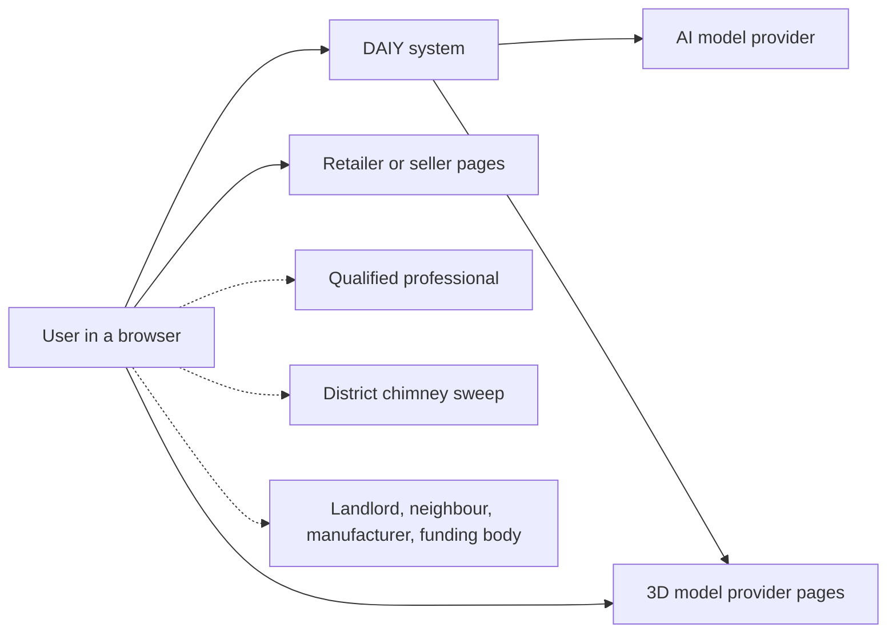
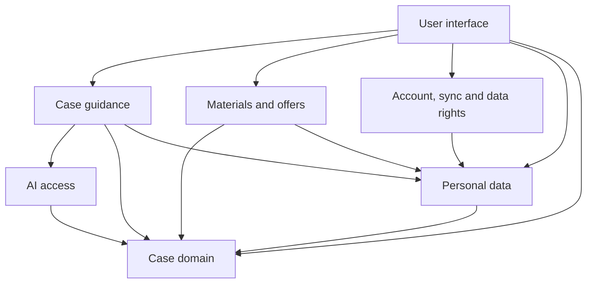
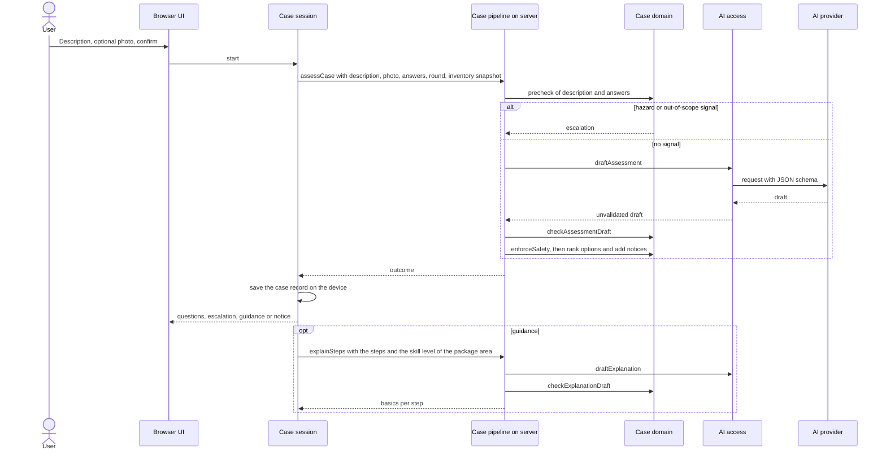
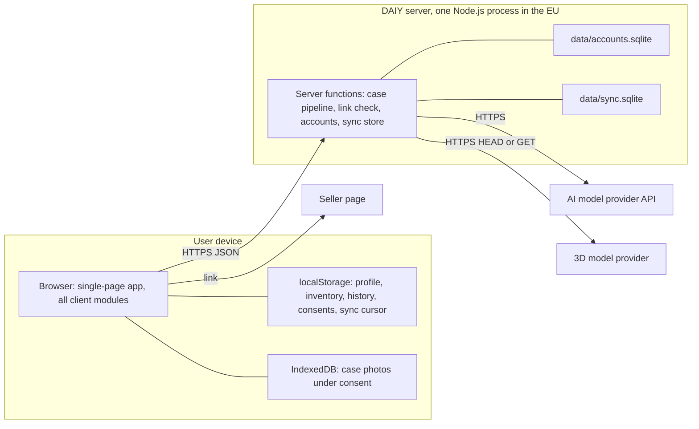

# ARC-001 The DAIY system as a whole

## Context

DAIY helps a person solve a repair problem or a small project. The person describes it in free text, with a photo if they want. The system asks follow-up questions, checks the case for hazards before and after an AI drafts an answer, and shows instructions, labelled work packages, materials, offers and legal notices that have passed validation. The SPEC sets the constraints that shape the whole system:

- the app works without an account, and profile and inventory are stored on the device (USE-WITHOUT-ACCOUNT, PROFILE-ON-DEVICE, INVENTORY-ON-DEVICE), with an optional account that syncs them (ACCOUNT-SYNC);
- every case is checked for risk before the AI is called, and no AI output is shown without validation (RISK-CHECK-FIRST, NO-UNVALIDATED-OUTPUT, OUTPUT-FORMAT-CHECK, OUTPUT-COMPLETENESS-CHECK, OUTPUT-PROHIBITED-PATH-CHECK, NO-GUIDE-AT-HIGH-RISK);
- the safety content and the package labels do not depend on the skill profile (SAFETY-CONTENT-PROFILE-INDEPENDENT, SKILL-DOES-NOT-UNLOCK);
- offers come from sample data, and purchases happen at the seller (SAMPLE-PRODUCT-DATA, REDIRECT-TO-SELLER, NO-IN-APP-PURCHASE);
- the user can export and delete their data, correct it and give or withdraw consent (DATA-EXPORT, DELETE-ALL-DATA, DATA-RECTIFICATION, DEVICE-STORAGE-CONSENT, CONSENT-WITHDRAWAL);
- every screen is accessible (UC-025, UC-026, UC-027).

The prototype in `prototype/` uses TypeScript, React and TanStack Start. It already has the right shape: a hazard pre-check before the AI, enforcement after it, sample offers and profiles kept only in the browser. This decision states the whole system. ARC-002 to ARC-008 state its subsystems, ARC-009 to ARC-018 make the further decisions, and one `MOD-<slug>.md` file describes each module.

### System context

| Element | Relation to the system |
|---|---|
| User | Uses DAIY in a browser on one or more devices. Owns the data on each device and, if they want, an account. |
| AI model provider | A remote LLM API, reached only by the DAIY server. It receives the case text, the photo, the follow-up answers and an inventory snapshot. For explanations it also receives the skill level of one area. It returns JSON drafts and stores nothing for DAIY. |
| Retailer or seller pages | The user follows a buy link to the seller's page (REDIRECT-TO-SELLER). No data is exchanged. |
| 3D model provider pages | Targets of the model links. The server checks whether a link is reachable before a model is suggested (UC-007 A4). |
| Professional, chimney sweep, landlord, neighbour, manufacturer, funding body | Never use the app. The app gives the user texts for them: the handover brief and the legal notices. |
| Sample catalogue | Product, second-hand and 3D-model sample data, kept inside the system's repository (SAMPLE-PRODUCT-DATA, ARC-018). |

## Decision

### Patterns

1. **Client-server with a fat client** (distributed). *Organises* the split between the browser and the DAIY server. The browser holds the UI, all personal data, inventory matching, offer search, cost estimates and the case state. The server holds only what cannot sit on the device: the AI key and the AI calls with the checks around them, the accounts and the synced copy. *Why:* an API key must never be in client code (ch. 10, API tokens). Profile and inventory stay on the device (PROFILE-ON-DEVICE, INVENTORY-ON-DEVICE, USE-WITHOUT-ACCOUNT). Sync needs one shared server (ACCOUNT-SYNC). The server keeps no case state: every request carries the whole case, so nothing is stored for a user without an account.
2. **Layers** (structuring). *Organises* the dependencies, from top to bottom: User interface → application subsystems (Case guidance, Materials and offers, Account, sync and data rights, Personal data) → AI access → Case domain. A layer uses only the layers below it. *Why:* the safety rules sit at the bottom, free of input and output, and both the client and the server can use them. They are testable on their own (design to test, divide and conquer).
3. **Pipe-and-filter** (structuring). *Organises* every AI request on the server as a chain of filters: hazard pre-check → AI draft → output check → safety enforcement → finishing (ranking, legal notices). The filters are passive and work on the pull principle. A filter may end the pipe with an outcome, either an escalation or a notice; no later filter then runs. The AI filter is reached only after the pre-check has passed. *Why:* RISK-CHECK-FIRST, NO-UNVALIDATED-OUTPUT, the three output checks and NO-GUIDE-AT-HIGH-RISK need a fixed order that no caller can bypass. Each filter can be tested alone.
4. **Repository** (structuring). *Organises* personal data on the device. One local store reads and writes profile, inventory, history and consent-gated data, and keeps one register of everything stored. Sync, export and delete-all read the whole store through it. *Why:* DATA-EXPORT, DELETE-ALL-DATA, ACCOUNT-SYNC and DEVICE-STORAGE-CONSENT each need all personal data in one place.
5. **Probabilistic reasoning above a deterministic boundary** (agentic, ch. 11). *Organises* the use of the AI. The AI only produces JSON drafts, constrained by a schema. It calls no tools and acts on nothing. What the user sees is decided by deterministic code below the boundary. *Why:* the safety requirements must hold whatever the model writes (NO-GUIDE-AT-HIGH-RISK, SKILL-DOES-NOT-UNLOCK, NO-OPENING-MAINS-HOUSINGS).

Patterns not used, and why:

- **Plug-ins:** no user groups whose processes differ only in detail (YAGNI).
- **Broker or service registry:** one client and one server, and no services that appear at runtime.
- **Tool calling or MCP:** the AI needs no actions, and tools would widen the prompt-injection surface (ch. 11).

### Subsystems

| Subsystem | Decision | Responsibility | Interface it offers | Runs on |
|---|---|---|---|---|
| Case domain | ARC-002 | The vocabulary of a case and the deterministic rules: hazard pre-check, output check, safety enforcement, legal notices, illustrations | Pure functions and types: case schemas, `precheck`, `detectHazards`, `escalationFor`, `checkAssessmentDraft`, `enforceSafety`, `noticesFor`, `illustration` | server and client |
| AI access | ARC-003 | The only path to the AI model: tasks with prompts and schemas, and the provider call | `draftAssessment`, `draftExplanation`, `draftStepAnswer`, which return unvalidated drafts | server |
| Case guidance | ARC-004 | Carries a case from input to a validated outcome and through its execution | Server functions `assessCase`, `explainSteps`, `answerStepQuestion`; client hook `useCaseSession` | server and client |
| Materials and offers | ARC-005 | Materials and tools against the inventory, offers and 3D models from the catalogue, costs and budget | `matchStock`, `searchOffers`, `searchModels`, `estimateCosts`; server function `checkLink` | client, with link check on the server |
| Personal data | ARC-006 | The on-device repository of profile, inventory, history and consents | `localStore`, the profile, inventory, history and consent functions | client |
| Account, sync and data rights | ARC-007 | The optional account, sync of the device data with it, and export and erasure across device and account | Account server functions, `push`, `pull`, `deleteSyncedData`; client `startSync`, `exportAll`, `eraseAll` | server and client |
| User interface | ARC-008 | Screens, navigation and accessibility | Routes for the browser; no interface for other subsystems | client |

### Logical view

The abstractions and how they depend on each other. An arrow means that a subsystem uses the interface of another.

The central abstractions are owned by MOD-case-model. A case request carries the description, the photo, the answers, the question round and an inventory snapshot. The AI returns an assessment draft. The pipeline turns it into one of four outcomes: follow-up questions, an escalation, guidance or a notice. Guidance consists of ranked solution options. Each option holds work packages, and each package has a label, a reason, a handover brief and, for DIY work, a guide with diagnosis, tools, materials, numbered steps, time and warnings. On the device, a case record holds the outcome and the user's progress.

### Process view

The behaviour at runtime when a case is assessed and then explained:

Rules of the process view:

- Every server function is stateless. A failure of the network, the provider or a check becomes a notice outcome and never an invented answer (UNDERSTANDABLE-ERROR-NOTICE).
- A question asked during the work goes through the same pipe with the pre-check first (STEP-QUESTION-HAZARD-CHECK).
- Sync runs in the background on the client. It starts when the app starts, after a local change and when the device comes back online, and it never blocks a case.
- The AI call has a timeout that serves the agreed response target (RESPONSE-TIME).

### Development view

```mermaid
flowchart TB
    subgraph UIS[User interface]
        shell[MOD-app-shell]
        cs[MOD-case-screens]
        ms[MOD-materials-screens]
        ds[MOD-data-screens]
        kit[MOD-ui-kit]
    end
    subgraph CGS[Case guidance]
        sess[MOD-case-session]
        pipe[MOD-case-pipeline]
    end
    subgraph MOS[Materials and offers]
        stock[MOD-stock-matching]
        cat[MOD-catalogue]
        link[MOD-link-check]
        cost[MOD-cost-estimate]
    end
    subgraph ASS[Account, sync and data rights]
        acc[MOD-accounts]
        sstore[MOD-sync-store]
        syncc[MOD-sync-client]
        port[MOD-data-portability]
    end
    subgraph PDS[Personal data]
        store[MOD-local-store]
        cons[MOD-consent]
        prof[MOD-profile]
        inv[MOD-inventory]
        hist[MOD-history]
    end
    subgraph AIS[AI access]
        tasks[MOD-ai-tasks]
        gw[MOD-ai-gateway]
    end
    subgraph CDS[Case domain]
        model[MOD-case-model]
        pre[MOD-hazard-precheck]
        chk[MOD-output-check]
        enf[MOD-safety-enforcement]
        notes[MOD-legal-notices]
        ill[MOD-illustrations]
    end
    shell --> cs
    shell --> ms
    shell --> ds
    shell --> kit
    shell --> syncc
    cs --> kit
    cs --> sess
    cs --> prof
    cs --> cons
    cs --> ill
    cs --> model
    cs --> ds
    ms --> kit
    ms --> sess
    ms --> stock
    ms --> cat
    ms --> cost
    ms --> inv
    ms --> model
    ds --> kit
    ds --> prof
    ds --> inv
    ds --> hist
    ds --> cons
    ds --> port
    ds --> syncc
    ds --> acc
    ds --> model
    sess --> pipe
    sess --> hist
    sess --> prof
    sess --> inv
    sess --> model
    pipe --> tasks
    pipe --> gw
    pipe --> pre
    pipe --> chk
    pipe --> enf
    pipe --> notes
    pipe --> model
    tasks --> gw
    tasks --> model
    tasks --> ill
    chk --> model
    chk --> ill
    enf --> pre
    enf --> model
    pre --> model
    notes --> model
    stock --> inv
    stock --> model
    cat --> link
    cat --> model
    cost --> stock
    cost --> cat
    cost --> model
    prof --> store
    prof --> model
    inv --> store
    inv --> model
    hist --> store
    hist --> model
    store --> cons
    syncc --> store
    syncc --> sstore
    syncc --> acc
    sstore --> acc
    sstore --> store
    port --> prof
    port --> inv
    port --> hist
    port --> cons
    port --> store
    port --> acc
    port --> sstore
    port --> syncc
```

The product's source lives in `prototype/`. Each module is one folder, `prototype/src/<slug>/`, named after the module's identifier without the prefix `MOD-`; MOD-case-model, for example, is the folder `prototype/src/case-model/`. Its public interface is `index.ts`, and its unit tests sit beside it as `*.test.ts`. A module imports another only through that `index.ts`. Subsystem tests live in `prototype/src/test/`, including the `safety.test.ts` the SPEC names. System tests live in `prototype/tests/system/` and evaluation cases in `prototype/eval/`. The file routes live in `prototype/src/app-shell/routes/` (ARC-009).

The module graph has no cycle. MOD-case-model, MOD-illustrations, MOD-ai-gateway, MOD-link-check, MOD-consent, MOD-accounts and MOD-ui-kit use no other module. MOD-case-pipeline uses MOD-ai-gateway only for the error type `AiError`, which MOD-ai-tasks passes on unchanged.

### Physical view

Where each part runs:

The server also delivers the app's static files. The secrets, the AI key and the session signing, exist only as environment variables of the server process (ARC-017).

### Scenarios

Each accepted use case is possible with the subsystems below. The scenarios name what takes part. They do not restate the steps.

- **UC-001 Start a case.**
  - The User interface shows the case input with a text field, an optional photo and a confirm action, so a case starts in three required inputs or fewer.
  - Case guidance reads an inventory snapshot from Personal data, downscales the photo and calls `assessCase`.
  - A missing profile or inventory yields defaults and blocks nothing.
  - The AI interprets the input with the inventory. The profile shapes the interpretation through the explanations of the steps (ARC-011).
  - The back action is a route change, and the session keeps the input.
- **UC-002 Clarify missing information.**
  - Safety enforcement in the Case domain turns a draft into a `questions` outcome and puts the model and variant questions first.
  - The request carries the round. At round 2, AI access asks for no questions and the output check rejects any.
  - Case guidance fills in answers given earlier by fact topic (REDUNDANT-ENTRY).
  - Assumptions travel in the guidance outcome. A case that is not safe without the missing information becomes a notice.
- **UC-003 Receive instructions.**
  - The pipeline of Case guidance runs the output check and safety enforcement of the Case domain. Enforcement inserts the fixed water, unplug and lock-out safety steps.
  - Options are ranked repair, then reuse, then buy-new.
  - `explainSteps` brings the basics at the profile level. The User interface collapses them by level and shows illustrations.
  - Every failure becomes a notice.
- **UC-004 Carry out the work.**
  - The User interface shows the steps. Case guidance stores the check-off states in the case record of Personal data.
  - Explain again uses `explainSteps` for one step, made simpler.
  - A question goes to `answerStepQuestion`, where the Case domain pre-check runs before any AI call.
- **UC-005 Check materials and tools.**
  - Materials and offers matches the guide's materials and tools against the inventory of Personal data. It marks each item available, partly available or missing, lists own stock first and lists missing tools apart.
  - Offers are searched only for the missing quantity.
- **UC-006 Compare offers.**
  - Materials and offers searches the sample catalogue by spec. Second-hand offers come first.
  - Every datum carries a certainty label, and a verified datum carries its source.
  - The buy link opens the seller's page. Rent or borrow hints come from the tool need.
- **UC-007 Suggest a 3D model.**
  - The Case domain treats an unclear safety-critical status as safety-critical.
  - Materials and offers suggests a model only for a printable part that is not safety-critical, with complete data and a link that the server's link check has found reachable. Otherwise it gives the professional-review note.
- **UC-008 Plan within a budget.**
  - Materials and offers computes the total per option from the chosen offers. Own stock costs nothing.
  - It compares the total with the budget kept in the case record, and lists the unverified prices and fits to check.
- **UC-009 Save owned items.**
  - The User interface lets the user mark listed items as owned and offers to save them. Personal data stores them in the inventory. Declining changes nothing.
- **UC-010 Label work packages.**
  - AI access drafts the packages without the profile.
  - The Case domain enforces the labels: mains-powered housing gives `professional only`, person-carrying furniture asks for load and dimensions or gives a conservative label, and an uncertain label becomes the stricter one with the deciding information.
  - Enforcement removes the guide where the label forbids it and adds the advice to agree preparation with the professional. Every package keeps a handover brief, which the User interface lets the user copy or share.
- **UC-011 Escalate hazards and out-of-scope work.**
  - The Case domain pre-check runs on the description and every answer, in English and German, before AI access is reached. It builds the escalation from the hazard catalogue: the actions of the detected kinds, emergencies first, the professional, the reason, and risk `critical` or `high`.
  - After the AI, safety enforcement turns any draft with high or critical risk, an out-of-scope area or an unclear risk at the last round into an escalation.
- **UC-012 Learn that the app is an AI.**
  - The User interface shows the AI notice on the case input screen, before the first AI call, as part of the screen and not as a required step.
- **UC-013 Set a skill profile.**
  - Personal data stores the levels per area in localStorage. `levelFor` returns beginner where no level is set.
  - Only sync of the Account, sync and data rights subsystem sends the profile to a server, and only for a user with an account.
- **UC-014 Manage the inventory.**
  - Personal data validates and stores materials and tools on the device. The User interface names the field in error.
- **UC-015 Deduct consumed materials.**
  - On completion, the User interface offers the used quantities from the case's stock match. Personal data deducts the confirmed quantities and never lets a quantity go below zero. Case guidance records the used materials in the case record.
- **UC-016 Keep the project history.**
  - Case guidance saves the case record after every change: steps with check-off states, used materials and notes.
  - The User interface lists ongoing and completed records from Personal data.
- **UC-017 Use the app without an account.**
  - No subsystem except Account, sync and data rights knows about accounts. The case pipeline is anonymous and stateless.
- **UC-018 Create an account and sync.**
  - The Account, sync and data rights subsystem creates the account with a scrypt-hashed password and offers a passkey as a sign-in without a cognitive test.
  - The sync client pushes and pulls the records of Personal data. The newest change wins, and changes made offline wait in the local store until a push succeeds.
- **UC-019 Be informed when data is collected.**
  - The User interface shows the privacy notice before the account form and beside the case input.
  - The account asks only for a user name and a password.
- **UC-020 Give and withdraw consent.**
  - Personal data keeps a register that gives each stored item its basis.
  - Keeping case photos needs consent, which the case input asks for when a photo is attached. Giving and withdrawing each take one action, and withdrawing purges the photos.
- **UC-021 Correct stored data.**
  - The setters of Personal data validate and store the corrected values, and so does the account's change of user name or password. Sync carries the correction to the account.
- **UC-022 Export my data.**
  - The Account, sync and data rights subsystem writes one JSON file with profile, inventory, history, consents and, where there is an account, its data.
- **UC-023 Delete all my data.**
  - The Account, sync and data rights subsystem deletes the synced data and the account on the server, which signs out every device. It then clears the local store, the photos and the consents, and reports anything that remains.
- **UC-024 Be pointed to legal duties.**
  - The AI draft names the notice kinds the case touches. The legal-notice catalogue of the Case domain supplies fixed texts with their marks, `check locally` and `check with manufacturer or funding body`.
  - The pipeline attaches notices to guidance only, so an escalation replaces them.
- **UC-025, UC-026, UC-027 Perceive, operate, enter input.**
  - The User interface builds every screen from MOD-ui-kit:
    - components that require a label and a text alternative;
    - colour tokens that meet the contrast thresholds;
    - a visible focus ring and pointer targets of at least 24 by 24 CSS pixels;
    - a single-column layout at 320 CSS pixels;
    - errors in text that name the field;
    - a polite live region for status messages.

### Testing

- **Modules:** unit tests with Vitest beside each module. Pure modules are tested on inputs and outputs. Modules with storage use jsdom localStorage and fake-indexeddb. Server modules use temporary SQLite files. MOD-case-pipeline is tested with MOD-ai-tasks replaced by a test double, so a test can show that no AI call happens on a hazard.
- **Subsystems:** one test file per subsystem in `prototype/src/test/` that uses only the subsystem's interface. For the Case domain this is `safety.test.ts`, which the SPEC names for the pre-check and the enforcement.
- **System:** Playwright tests in `prototype/tests/system/` run the built app against a local stub of the AI provider. They cover the use cases end to end, including going back, the keyboard alone, and axe accessibility checks at 320 CSS pixels and at 200 percent text.
- **Review:** the evaluation cases in `prototype/eval/` run against the real model and support the checks the SPEC leaves to review, such as classification cases, profile pairs and the 95th-percentile response time.
- **Architecture:** checked by review, not by tests.

### Principles

- **Divide and conquer, and one responsibility per file:** seven subsystems with 28 modules, each with one responsibility.
- **Design to test:** the rules are pure, and the AI sits behind one module that can be replaced in tests.
- **KISS and YAGNI:** one server process, SQLite, no tool calling, no plug-ins, and sample data instead of retailer integrations.
- **DRY:**
  - every data format is defined once, in its owning module;
  - hazard actions, legal notices and fixed safety steps each live in one catalogue;
  - spec matching serves both products and 3D models.
- **Develop against interfaces:** a module is used only through its `index.ts`.

## Alternatives

- **Thin client, with all logic and data on the server.** Rejected: profile and inventory must stay on the device (PROFILE-ON-DEVICE, INVENTORY-ON-DEVICE), and the app must work without an account (USE-WITHOUT-ACCOUNT).
- **Client only, calling the AI from the browser.** Rejected: the API key would be exposed, and a user could bypass the pre-check and the output checks (RISK-CHECK-FIRST, NO-UNVALIDATED-OUTPUT).
- **A model on the device.** Rejected: the models that are good enough do not fit on consumer devices today (ch. 10).
- **Microservices, one service per subsystem.** Rejected: there is no scaling or team need, and it adds network boundaries (KISS).
- **An agent with tools that look up offers or write the inventory.** Rejected: no requirement needs the AI to act. Deterministic code does the matching and the search, which keeps them verifiable (INVENTORY-GROUNDING, PRODUCT-MATCHING-BY-SPEC).

## Consequences

- The server must be reachable for every AI answer. Offline, the app shows a notice, and the profile, the inventory, the history and the work on an answered case keep working.
- Each request carries the whole case, which makes requests larger, but the server holds no case data.
- The AI provider is a recipient of the case data and must be named in the privacy notice (PRIVACY-NOTICE).
- Changing a safety rule touches only the Case domain, and its tests show the effect.
