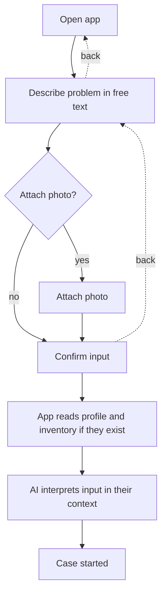

# UC-001 Start a case

## Actors

- User: a person with a repair problem or a small project.
- App: the DAIY application.
- AI: the AI component that interprets the input.

## Precondition

The app is open. A skill profile and a material and tool inventory may exist, but none is required.

## Main flow

1. The user opens the app and sees the input screen of a new case.
2. The user describes the repair problem or small project in plain-language free text.
3. The user confirms the input.
4. The app reads the stored skill profile and the stored inventory, where they exist.
5. The AI interprets the input in the context of the stored skill profile and of the stored inventory.
6. The app starts the case.

The user needs no knowledge of how to write a good prompt: plain-language free text is enough, and the app asks for no prompt format. A beginner and an experienced user start the case without help.

The main flow needs at most three required input steps from opening the app to the started case. Every screen of the case offers a back action. The back action returns the user to the previous screen with the earlier input kept.

## Alternative flows

- A1, photo: while describing the problem the user attaches a photo to the free text. The app accepts it and the AI takes it into account. A user who attaches no photo is never asked for one.
- A2, no skill profile: the app starts the case without waiting for a profile. The case is handled as for a beginner.
- A3, no inventory: the app starts the case without waiting for an inventory. The interpretation uses no inventory.
- A4, empty profile and empty inventory: the case starts and is answered as in the main flow.
- A5, no prompting knowledge: the user writes a short or vague description. The app still starts the case and obtains what it lacks through the follow-up questions of UC-002, not by asking the user to reword a prompt.
- A6, going back: at any screen of the case the user chooses the back action and arrives at the previous screen. The user can change the input and continue.

## Postcondition

A case exists that holds the user's description, the optional photo and the interpretation made in the context of the stored profile and inventory. The user was never blocked by a missing profile or a missing inventory, and needed no prompting skill to start.

## Diagram

