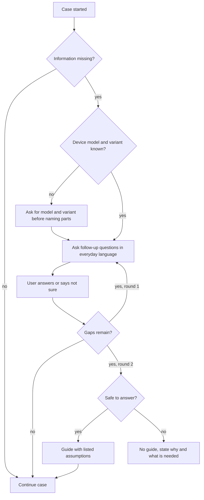

# UC-002 Clarify missing information

## Actors

- User: the person whose case lacks information.
- App: the DAIY application.
- AI: the AI component that finds the gaps and words the questions.

## Precondition

A case has been started (UC-001) and the AI finds that it lacks information it needs to find a suitable solution.

## Main flow

1. The AI names the information that is missing.
2. If the case concerns a device and its exact model and variant are unknown, the app asks for the model and variant first. It names no part before they are known.
3. The app asks the user targeted follow-up questions in everyday language. A technical term in a question is explained where it appears.
4. The user answers the questions.
5. The app checks whether the answers close the gaps. If gaps remain, it asks a second round of follow-up questions, worded as in the first round.
6. The app continues the case with the answers.

There are at most two rounds of follow-up questions in a case.

## Alternative flows

- A1, answer "not sure": the user answers a question with "not sure" or leaves it open. The app accepts this and does not repeat the question.
- A2, gaps remain after two rounds: the app asks no third round. If the case is safe to answer, the app gives a guide with a clearly listed list of the assumptions it made. Every assumption is shown as an assumption and never as an established fact.
- A3, not safe without the missing information: the app gives no guide. It states why and what is needed.
- A4, uncertain classification: if the classification of a work package stays uncertain, the app names the information that would change the label. Which label applies is decided by the rules for classification, not by this use case.
- A5, nothing missing: the AI finds no gap, and the use case ends without a question.

## Postcondition

The case either holds the information it needs, or it holds a list of assumptions that the user can see. No assumed detail is presented as a fact. The user has been asked no more than two rounds of questions.

## Diagram

