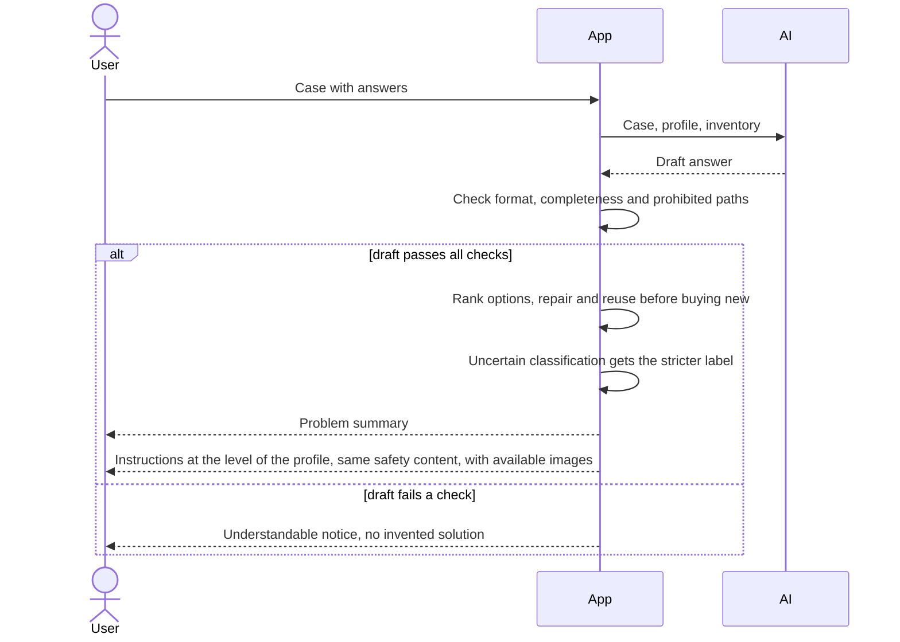

# UC-003 Receive instructions

## Actors

- User: the person who wants to solve the problem.
- App: the DAIY application, which validates the AI output.
- AI: the AI component that drafts the answer.

## Precondition

A case has been started (UC-001). Missing information has been clarified or has been replaced by listed assumptions (UC-002). The case is not one for which the app gives no instructions (UC-011).

## Main flow

1. The AI drafts the answer from the case, the skill profile and the inventory.
2. The app validates every draft. It checks the draft for the expected format, for completeness, and for prohibited or risky output paths. Only a draft that passes all three checks goes on.
3. The app shows the user a summary of the problem that the user can follow.
4. The app ranks the solution options. Repair comes before buying new, and reuse comes before buying new.
5. The app shows the instructions for the chosen option. They contain the diagnosis, the required tools, the required materials, the numbered steps, the estimated time and the warnings.
6. The steps are written in short sentences. A technical term is avoided or explained where it first appears.
7. The level of detail follows the user's skill profile. A user without a profile gets the beginner level. The safety content of the instructions is the same for every skill profile.
8. A guide for water-related work starts with shutting off the water supply.
9. A guide that opens an electrical device tells the user to unplug it before the first opening step.
10. Where the instructions involve switching off an electrical circuit, they never present switching off the circuit breaker as enough to secure the circuit against being switched on again.
11. Where illustrative images are available for the case, the instructions include them.
12. The user reads the instructions.

## Alternative flows

- A1, advanced profile: basic explanations are collapsed or skipped. The user can expand each of them at any time. Warnings and safety steps stay in full.
- A2, beginner profile: the basic explanations are shown in full. The user can collapse them.
- A3, draft fails validation: the draft is malformed, incomplete, or takes a prohibited or risky path. The app does not show the draft. It shows an understandable notice instead and invents no solution.
- A4, no repair or reuse option: the app proposes buying new. It shows this option after any repair or reuse option that exists.
- A5, uncertain classification: if the classification of a work package is uncertain, the app chooses the more restrictive label. The instructions name the information that would change the label, as for an uncertain classification in UC-002.
- A6, no images available: the instructions are shown without images and the case is not blocked.

## Postcondition

The user holds a validated answer with a problem summary and a complete, numbered set of instructions at the level of the profile, with the available illustrative images. No AI output reached the user without passing the format, completeness and path checks. The safety content is identical for every skill profile. No work package of uncertain classification carries a less restrictive label than the stricter one.

## Diagram

