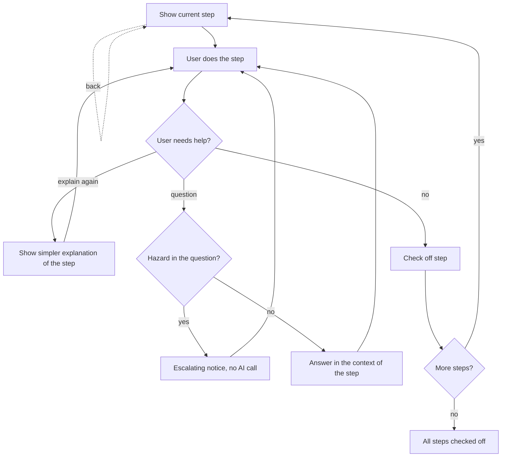

# UC-004 Carry out the work step by step

## Actors

- User: the person doing the work.
- App: the DAIY application.
- AI: the AI component that answers questions about a step.

## Precondition

The user holds validated instructions with numbered steps (UC-003) and starts the work.

## Main flow

1. The app shows the instructions step by step and marks the current step.
2. The user does the step.
3. The user checks off the step. The app shows the step as done and keeps this state.
4. The app moves on to the next step.
5. The user repeats doing, checking off and moving on until every step is checked off.

## Alternative flows

- A1, explain again: during a step the user asks for it to be explained again or simplified. The app shows a new, simpler explanation of that step. The step keeps its place and its check-off state.
- A2, follow-up question: during a step the user asks a question. The app first checks the question for hazard signals. If it contains none, the AI answers in the context of the current step and the app shows the answer after validation. The user then goes on with the step.
- A3, hazard in the question: the question contains a hazard signal. The app answers with an escalating notice, as in UC-011, and makes no AI call.
- A4, going back: the user goes back to an earlier step. Its check-off state is kept.
- A5, leaving and returning: the user leaves the instructions and returns. The check-off states are shown as left.
- A6, uncheck: the user removes the check from a step. The app shows the step as open again.

## Postcondition

Every step the user finished is checked off, and the state of each step is kept. Questions asked during the work were answered in the context of their step, or were answered with an escalating notice when they contained a hazard.

## Diagram

