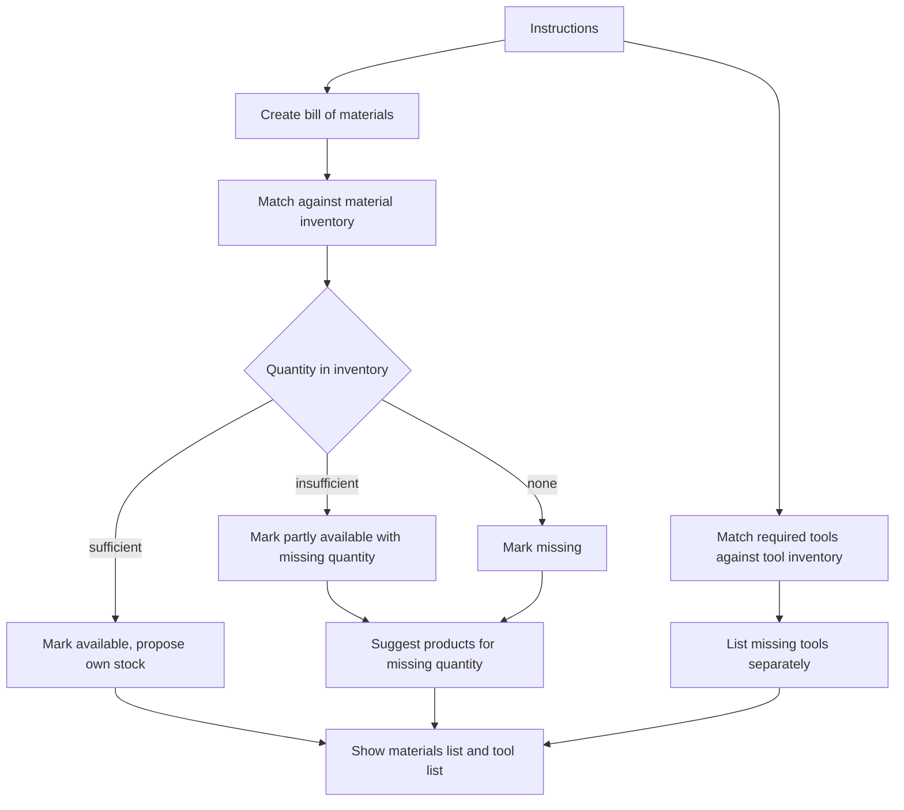

# UC-005 Check materials and tools against the inventory

## Actors

- User: the person who needs to know what to get.
- App: the DAIY application.
- Inventory: the user's stored materials and tools, which may be empty.

## Precondition

The user holds instructions (UC-003) that name materials, tools or both.

## Main flow

1. The app creates the bill of materials from the instructions. It matches the materials named in the steps.
2. The app matches every item of the bill of materials against the material inventory.
3. The app shows for every item whether the inventory holds it in sufficient quantity.
4. The app proposes matching items from the user's own inventory first.
5. The app matches the required tools against the tool inventory and lists the missing tools in a list of their own, apart from the missing materials.
6. For each missing material, the app suggests products to buy. It suggests no product for an item that is available in sufficient quantity.

## Alternative flows

- A1, partly available: the inventory holds an item in insufficient quantity. The app marks it "partly available" together with the missing quantity. Product suggestions cover the missing quantity only.
- A2, empty inventory: every item shows as missing. The app suggests products for all of them and the case is not blocked.
- A3, no materials needed: the instructions name no material. The app shows no materials list.
- A4, no missing tools: the list of missing tools is not shown.
- A5, matching own item: an inventory item matches a required item. The app proposes it before it shows any product to buy.

## Postcondition

The user sees a materials list that matches the steps, with the inventory status of every item, the missing quantities and a separate list of missing tools. Products are suggested only for what is missing.

## Diagram

