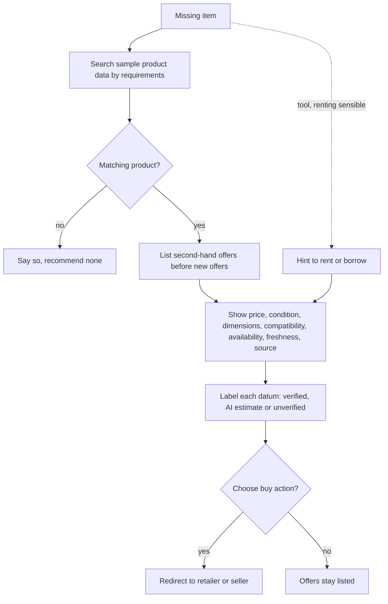

# UC-006 Compare offers for a missing item

## Actors

- User: the person who needs to get a missing material.
- App: the DAIY application.
- Seller: the retailer or seller whose page holds the offer. The app does not sell for it.

## Precondition

The app shows the materials list of a case (UC-005) and an item of it is missing or only partly available.

## Main flow

1. The user chooses a missing item.
2. The app searches the sample product data set for products that meet the concrete requirements of the item, such as dimensions, material and function. It does not recommend a product that fails them.
3. The app lists the offers. Second-hand offers come before every new offer.
4. For every offer the app shows its price, condition, dimensions and compatibility, its availability, the age of its data and the source of its data.
5. The app labels every specification and product datum with exactly one of three labels: verified product data, AI estimate or unverified information. The label matches the origin of the datum. A datum labelled verified names its source.
6. Where an alternative may be more sustainable, the app gives the reason. It makes no CO₂ claim that it cannot support.
7. The user chooses an offer and the buy action.
8. The app redirects the user to the page of the retailer or seller. The purchase takes place there.

The app has no purchase function of its own.

## Alternative flows

- A1, no second-hand data: no suitable second-hand data exists for the item. The app lists new offers only and shows no second-hand claim.
- A2, unverified compatibility: the compatibility of a product is not verified. The app marks it as uncertain.
- A3, insufficient evidence: a second-hand listing lacks evidence for compatibility, availability or quality. The app makes no claim about it and shows the lack.
- A4, missing tool: the item is a missing tool. Where renting or borrowing is sensible, the app adds a hint to rent or borrow it beside the offers.
- A5, no matching product: no product meets the requirements. The app says so and recommends none.
- A6, sample data: the product data are sample data for the MVP. The app shows them as such, not as live prices.

## Postcondition

The user has seen matching offers, second-hand ones first, each with its comparison data, availability, freshness, source and certainty label. A purchase, if the user chose one, was made at the seller, not in the app.

## Diagram

