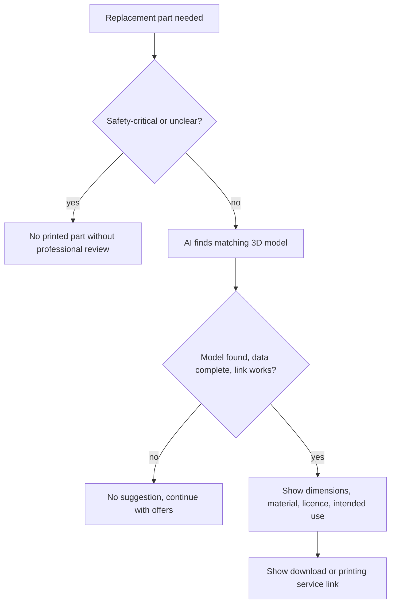

# UC-007 Suggest a 3D model for a replacement part

## Actors

- User: the person who needs a replacement part.
- App: the DAIY application.
- AI: the AI component that finds a matching model.
- Model provider: the site that offers the download or the printing service.

## Precondition

The case needs a replacement part that is a missing item (UC-005).

## Main flow

1. The app decides whether the part is safety-critical.
2. The part is not safety-critical and suitable for printing. The AI finds a matching 3D model.
3. The app shows the suggested model with its dimensions, material requirements, licence and intended use.
4. The app shows a link to a download or to a printing service.
5. The user follows the link.

## Alternative flows

- A1, safety-critical part: the app recommends no printed part. It recommends one only together with a professional review, and says so.
- A2, unclear whether safety-critical: the app treats the part as safety-critical.
- A3, no matching model: the app suggests no model and the case goes on with the offers of UC-006.
- A4, link not working: the app does not show the model as a suggestion.
- A5, incomplete model data: the model lacks dimensions, material requirements, licence or intended use. The app does not suggest it.

## Postcondition

The user has a suggested 3D model with its dimensions, material requirements, licence, intended use and a working link, or no model was suggested. No printed part was recommended for a safety-critical use without professional review.

## Diagram

