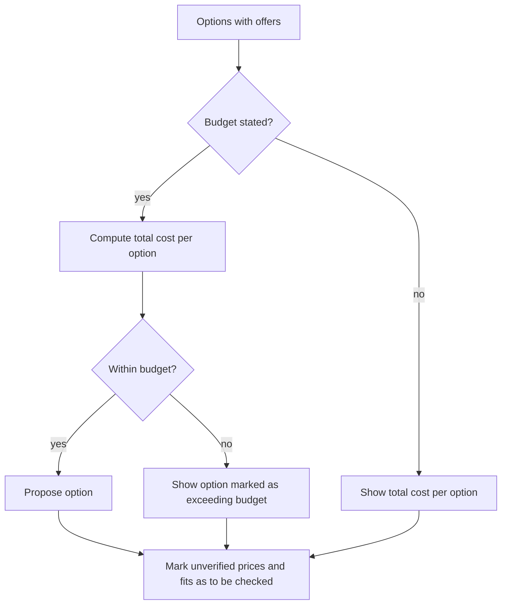

# UC-008 Plan within a budget

## Actors

- User: the person who has a budget for the case.
- App: the DAIY application.

## Precondition

The app proposes options for a case (UC-003) and has offers for their missing items (UC-006). The user may state a budget; none is required.

## Main flow

1. The user states a budget.
2. The app computes the estimated total cost of each option from the prices of its items.
3. The app shows the total cost estimate for every option, consistent with the item prices.
4. The app proposes options within the budget. An option above the budget stays shown, marked as exceeding it.
5. The app marks every price or fit that is not verified as still to be checked.
6. The user chooses an option.

## Alternative flows

- A1, no budget: the user states none. The app shows the total cost estimate of each option without a budget comparison.
- A2, no option within budget: the app says so and shows the options marked as exceeding it.
- A3, own stock: items from the user's own inventory add no cost to the total.
- A4, budget changed: the user changes the budget. The app marks the options again.

## Postcondition

Every proposed option shows a total cost estimate. Options stay within the stated budget or are marked as exceeding it. Prices and fits that still need checking are marked.

## Diagram

