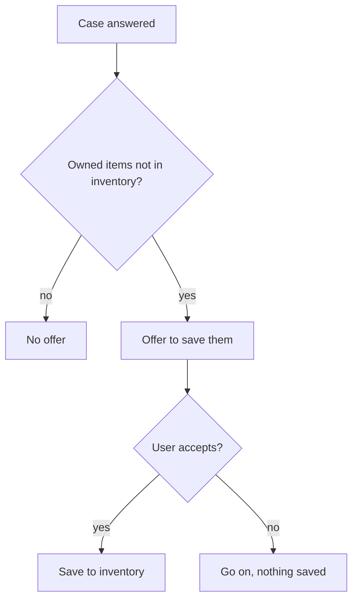

# UC-009 Save owned items to the inventory

## Actors

- User: the person who owns some of the listed items.
- App: the DAIY application.
- Inventory: the user's stored materials and tools.

## Precondition

A case has been answered (UC-003) and its instructions list items. The user already owns some of them and they are not yet in the inventory.

## Main flow

1. The app offers to save the listed items the user already owns to the inventory.
2. The user accepts.
3. The app saves the items to the inventory.

The offer is never required.

## Alternative flows

- A1, declined: the user declines. Nothing is saved and the user goes on using the app.
- A2, ignored: the user does not answer. The app is not blocked.
- A3, nothing to save: no listed item is owned and missing from the inventory. The app makes no offer.

## Postcondition

The accepted items are in the inventory. Declining the offer blocked nothing.

## Diagram

