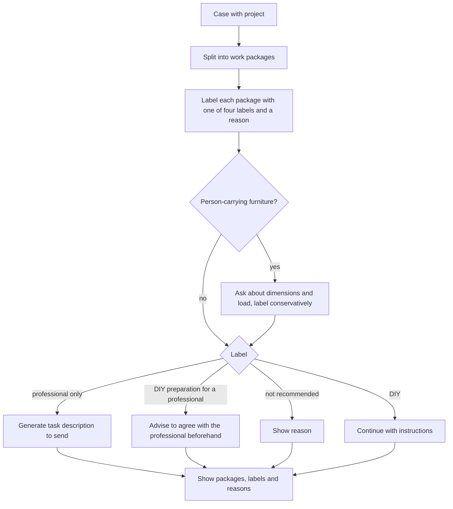

# UC-010 Label the work packages of a project

## Actors

- User: the person who plans a repair or small project.
- App: the DAIY application.
- AI: the AI component that proposes the work packages and their labels.
- Professional: a qualified tradesperson to whom the user hands over a package. The Professional does not use the app.

## Precondition

A case has been started (UC-001) and the pre-check of UC-011 has not escalated it. Missing information has been clarified or replaced by listed assumptions (UC-002).

## Main flow

1. The app splits a project with several tasks into separate work packages.
2. The app gives each work package exactly one label: "DIY", "DIY preparation for a professional", "professional only" or "not recommended".
3. The app shows a short reason beside each label.
4. The app shows the work packages with their labels and reasons. The label and the reason do not depend on the user's skill profile.
5. For each package labelled "professional only", the app generates a short task description that the user can send to a professional.
6. For each package labelled "DIY preparation for a professional", the app tells the user to agree the preparatory work with the professional beforehand. It does not present the preparation as a standard path.
7. The user continues with the DIY packages (UC-003).

A project with a single task is one work package and is labelled in the same way.

## Alternative flows

- A1, advanced profile: a high self-assessed skill level changes no label. A package that is "professional only" or "not recommended" for a beginner has the same label for an advanced user.
- A2, repair inside a mains-powered device: a task that opens a mains-powered housing is labelled "professional only" for every skill profile. The app gives no instructions that open it.
- A3, furniture that carries a person: the app labels the package conservatively. It asks the user about the dimensions and about the load before it gives a label that is less restrictive.
- A4, uncertain classification: the more restrictive label applies, as in UC-003 A5, and the app names the information that would change it.
- A5, no "professional only" package: no task description is generated.
- A6, single task: the plan consists of one work package.

## Postcondition

Every work package of the project carries exactly one of the four labels and a short reason. Every "professional only" package has a task description that can be sent. Every "DIY preparation for a professional" package carries the advice to agree it with the professional beforehand. The labels are the same for a beginner and for an advanced profile.

## Diagram

