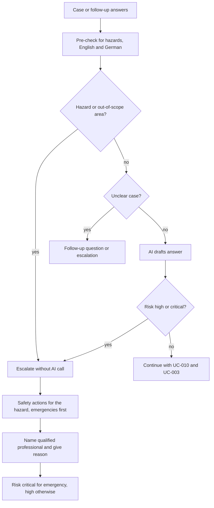

# UC-011 Escalate hazards and out-of-scope work

## Actors

- User: the person whose case contains a hazard or out-of-scope work.
- App: the DAIY application, which checks every case before and after the AI.
- AI: the AI component that drafts answers for cases the app does not escalate.
- Professional: the qualified professional the app names. The Professional does not use the app.

## Precondition

A case has been started (UC-001), or the user has answered follow-up questions (UC-002).

## Main flow

1. Before any instructions are given and before any AI call, the app checks the problem text and the user's answers to follow-up questions for hazard signals. The check recognises hazards described in English and in German.
2. The check finds an immediate hazard, or work in an out-of-scope area: fixed 230/400 V installations, grid connection, gas installations, refrigerant circuits, load-bearing structures or chimneys.
3. The app escalates the case without an AI call and gives no DIY instructions.
4. The app gives the immediate safety actions that fit the detected kind of hazard, and no actions that belong to another kind of hazard.
5. The app names the kind of qualified professional to contact for that hazard.
6. The app states why it gives no instructions.
7. The app shows the escalation with the risk level "critical" for an emergency and "high" for out-of-scope work that is not an emergency.

The check does not escalate installation work that can be one package of a larger project, such as a new socket, a ceiling light or a wallbox. Such work goes on to UC-010.

## Alternative flows

- A1, several hazards: the escalation lists the emergency actions and the professional for the emergency before the other actions.
- A2, hazard only in a follow-up answer: the problem text is harmless and an answer to a follow-up question contains a hazard. The app escalates without an AI call.
- A3, no hazard signal: the app passes the case to the AI. The app then checks the AI output. An output with risk "high" or "critical" is never shown as a guide. The app turns it into an escalation without a guide.
- A4, unclear case: the case is not classified as safe. It leads to a follow-up question (UC-002) or to an escalation, never to a DIY guide.
- A5, energy renovation: the user asks for a full energy renovation or a funding application. The app does not plan or certify it. It points out the topic and who is responsible.
- A6, step question: a hazard in a question during the work is handled as in UC-004 A3.

## Postcondition

Every case was checked for hazards before instructions were given. A case with a hazard or out-of-scope work holds an escalation with a reason, the kind of professional, the fitting safety actions and a risk level, and no DIY instructions. No output with risk "high" or "critical" was shown as a guide.

## Diagram

