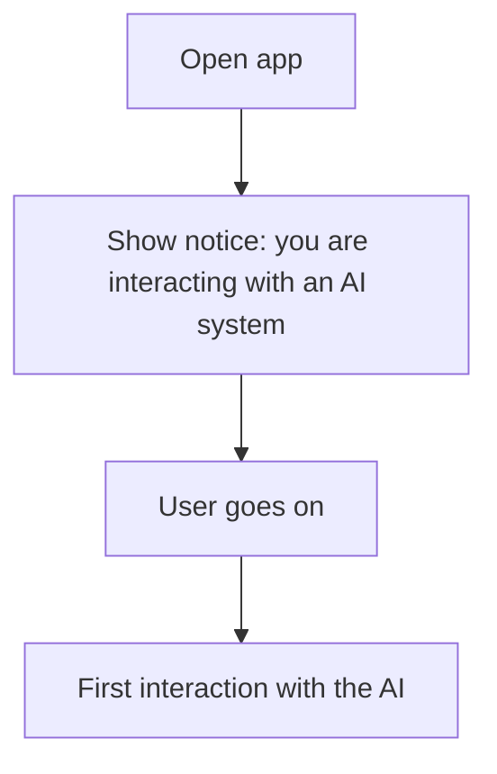

# UC-012 Learn that the app is an AI

## Actors

- User: a person who uses the app, possibly for the first time.
- App: the DAIY application.
- AI: the AI system the user interacts with through the app.

## Precondition

The user has not yet interacted with the AI.

## Main flow

1. The user opens the app.
2. The app clearly informs the user that they are interacting with an AI system.
3. The user reads the notice and goes on.
4. The first interaction with the AI takes place.

The notice is shown at or before the first interaction. It is not a required input step of UC-001.

## Alternative flows

- A1, notice already seen: the user has seen the notice before. The app keeps it available and does not block the case.
- A2, notice ignored: the user does not react to the notice. The app is not blocked.

## Postcondition

The user was informed that they interact with an AI system at the latest at the first interaction with the AI.

## Diagram

