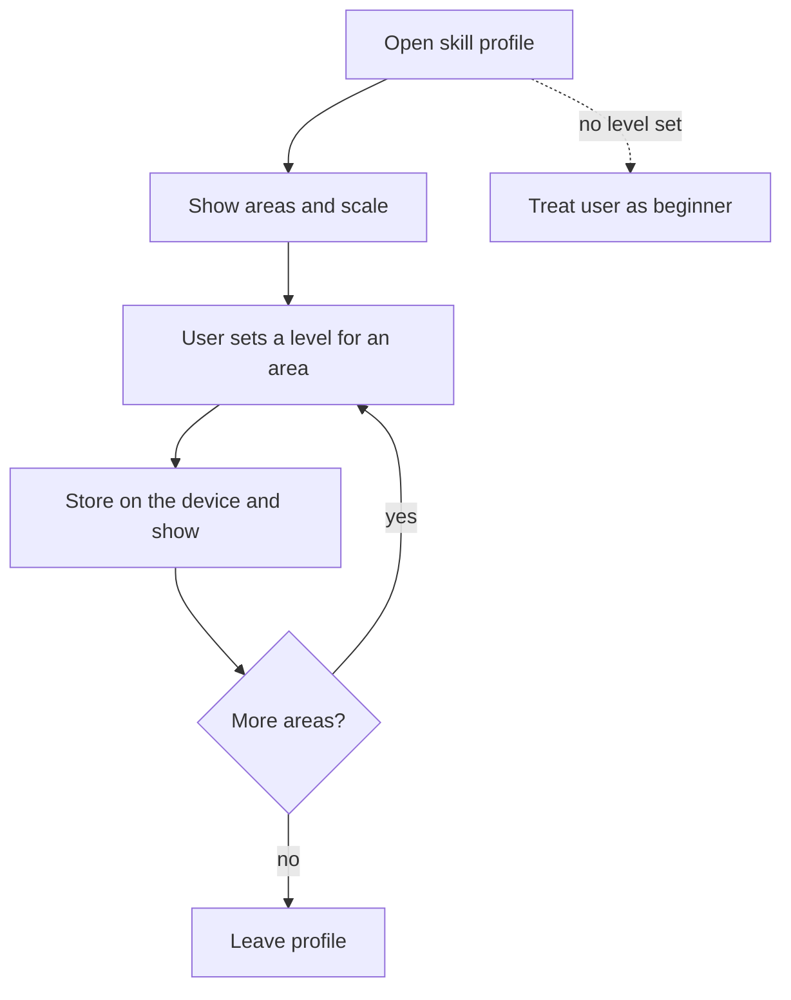

# UC-013 Set a skill profile

## Actors

- User: a person who wants the instructions to fit their experience.
- App: the DAIY application.

## Precondition

The app is open. No profile is required.

## Main flow

1. The user opens the skill profile.
2. The app lists the areas of work and a simple scale of experience for each.
3. The user sets a level for an area.
4. The app stores the level on the device and shows it in the profile.
5. The user sets and stores a level for further areas in the same way and leaves the profile.

The app writes the profile to the local storage of the device only. It sends the profile to no server for storage.

## Alternative flows

- A1, no profile: the user sets no level. The app treats the user as a beginner. The answer for a user without a profile equals the answer for an explicit beginner profile.
- A2, change of level: the user sets another level for an area. The app stores and shows the new level.
- A3, area left open: the user sets a level for some areas only. The app treats every area without a level as beginner.
- A4, account: the user has an account with sync (UC-018). The profile then also reaches the account, and only through that sync and only after the user created the account.

## Postcondition

Every level the user set is stored on the device and shown. Where no level exists, the app treats the user as a beginner. No profile was sent to a server for storage without an account.

## Diagram

