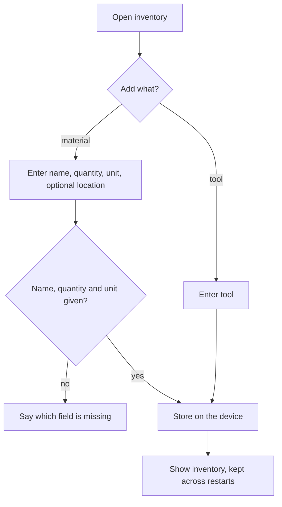

# UC-014 Manage the material and tool inventory

## Actors

- User: the person who owns materials and tools.
- App: the DAIY application.
- Inventory: the user's stored materials and tools, which may be empty.

## Precondition

The app is open. No account is required.

## Main flow

1. The user opens the inventory.
2. The user adds a material with its name, quantity and unit, and optionally a location.
3. The app stores the material on the device and shows it in the inventory.
4. The user adds a tool they own.
5. The app stores the tool on the device and shows it in the inventory.

The inventory stays on the device. After a restart of the app the stored materials and tools are still there. UC-005 matches the stored materials and tools against the needs of a case.

## Alternative flows

- A1, no location: the user leaves the location empty. The app stores the material without a location.
- A2, change or removal: the user changes the quantity, unit or location of an item, or removes the item. The app stores the change.
- A3, incomplete item: name, quantity or unit of a material is missing. The app does not store the item and says which field is missing.
- A4, no account: the user has no account. The inventory works in the same way and persists across restarts.
- A5, account: the user has an account with sync (UC-018). The inventory then also reaches the account, and only through that sync.
- A6, items from a case: the user saves owned items listed in a case (UC-009). They join the same inventory.

## Postcondition

Every material in the inventory holds name, quantity, unit and, where given, a location. Every tool the user recorded is stored. All of it persists across restarts on the device.

## Diagram

