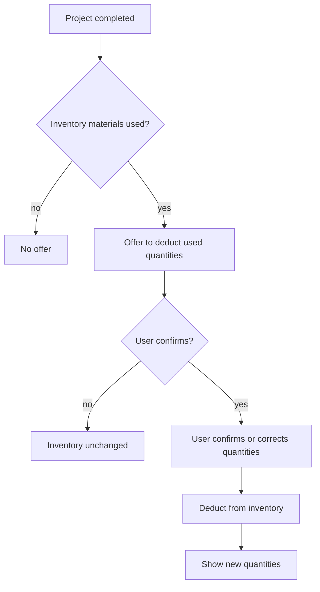

# UC-015 Deduct consumed materials after a project

## Actors

- User: the person who finished a project.
- App: the DAIY application.
- Inventory: the user's stored materials.

## Precondition

The user has carried out the work of a case (UC-004) and marks the project as completed.

## Main flow

1. The app lists the materials of the project that the inventory holds, each with the quantity the instructions planned.
2. The app offers to deduct the quantities used from the inventory.
3. The user confirms or corrects the used quantity of each material.
4. The app deducts the confirmed quantities from the inventory.
5. The app shows the new inventory quantities.

Nothing is deducted without the user's confirmation.

## Alternative flows

- A1, declined: the user declines. The inventory stays as it was and the user goes on.
- A2, used more than held: the confirmed quantity exceeds the quantity in the inventory. The app sets the quantity to zero and does not store a negative quantity.
- A3, no inventory material used: the project used no material from the inventory. The app makes no offer.
- A4, corrected quantity: the user enters a quantity different from the planned one. The app deducts the quantity the user entered.

## Postcondition

The inventory quantities of the confirmed materials have decreased by the confirmed used quantities. Without a confirmation no quantity changed.

## Diagram

