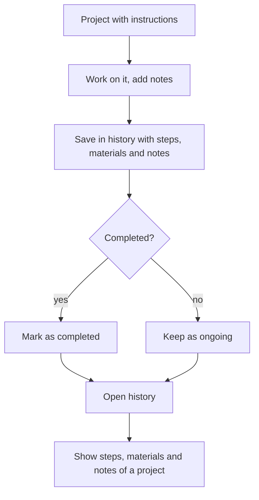

# UC-016 Keep the project history

## Actors

- User: the person who works on projects over time.
- App: the DAIY application.

## Precondition

A case has been started (UC-001) and has a project with instructions (UC-003).

## Main flow

1. The user works on the project (UC-004) and may add notes to it.
2. The app saves the project in the history with its steps, the materials used and the notes.
3. The user completes the project.
4. The app marks the project as completed in the history.
5. The user opens the history and sees completed and ongoing projects.
6. The user opens a project and sees its steps, materials used and notes.

## Alternative flows

- A1, ongoing project: the user leaves a project open. It stays in the history as ongoing, with its steps and check-off states, materials and notes so far.
- A2, notes changed: the user changes a note. The app stores the change.
- A3, empty history: no project exists. The app shows an empty history.
- A4, materials deducted: the user confirms the used materials (UC-015). The materials of the history entry show the confirmed quantities.

## Postcondition

Every completed and every ongoing project is in the history with its steps, materials used and notes.

## Diagram

