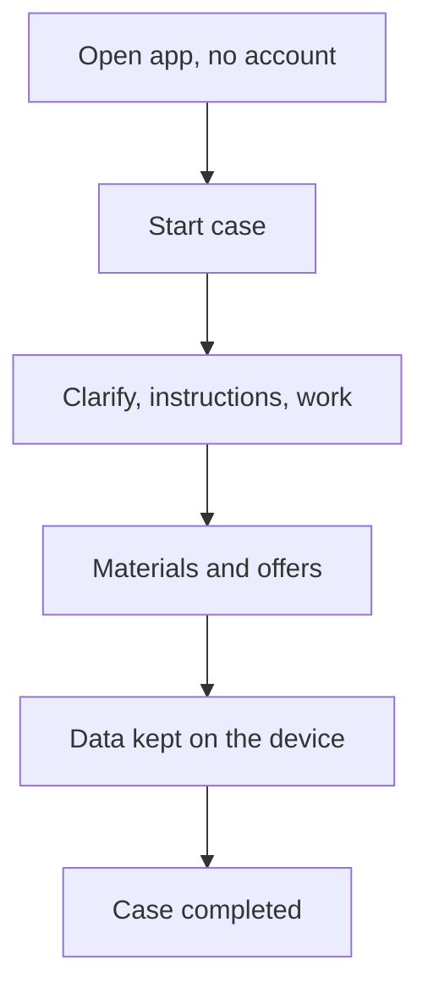

# UC-017 Use the app without an account

## Actors

- User: a person who does not want an account.
- App: the DAIY application.

## Precondition

The app is open. The user has no account.

## Main flow

1. The user starts a case (UC-001) without being asked to sign in or to create an account.
2. The user goes through the case from clarification to instructions and the work (UC-002, UC-003, UC-004).
3. The user checks materials and offers (UC-005, UC-006).
4. The app keeps profile, inventory and history on the device (UC-013, UC-014, UC-016).
5. The user completes the case.

No function of the case needs an account.

## Alternative flows

- A1, account later: the user creates an account at any time (UC-018). The app does not require it for any step of the case.
- A2, restart: the user closes and reopens the app. The data on the device is still there.

## Postcondition

The user completed a full case without an account and was never asked to create one as a condition.

## Diagram

