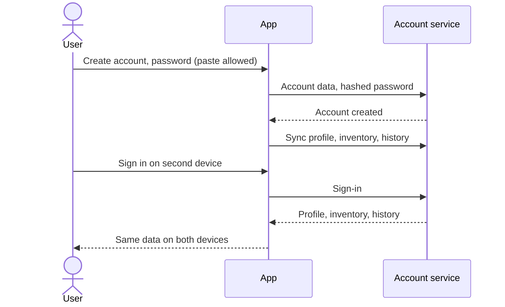

# UC-018 Create an account and sync across devices

## Actors

- User: a person who uses the app on more than one device.
- App: the DAIY application.
- Account service: the part that stores accounts and the synced data.

## Precondition

The app is open on a device. The user chooses to create an account. No account is needed to use the app (UC-017).

## Main flow

1. The user chooses to create an account and sees the privacy notice (UC-019).
2. The user enters the data the account needs and a password.
3. The app stores the password hashed. No password is stored in plain text.
4. The app creates the account and syncs profile, inventory and history to it.
5. On a second device the user signs in.
6. The app loads profile, inventory and history from the account to the second device.
7. A change on one device reaches the other device through the sync.

Sign-in requires no cognitive function test unless an alternative method or a mechanism to assist the user is available. The password field allows pasting and the use of a password manager.

A new account shares no personal data with other users. The data becomes visible to others only after the user shares it.

## Alternative flows

- A1, sign-in method without a cognitive test: the app offers a sign-in method that needs no remembering, transcribing or solving, in addition to the password.
- A2, wrong credentials: the app says that the sign-in failed and lets the user try again.
- A3, sync not possible: the device is offline. The change stays on the device and syncs when a connection exists.
- A4, conflicting changes: the same item was changed on two devices. The app keeps the newer change.
- A5, no account: the user declines. Nothing is synced and the app works as in UC-017.
- A6, sharing: the user shares data with other people. The app shares only what the user chose.

## Postcondition

The account holds the synced profile, inventory and history. The stored account data contains no plain-text password. The user can sign in without a cognitive function test. No personal data is visible to other users unless the user shared it.

## Diagram

