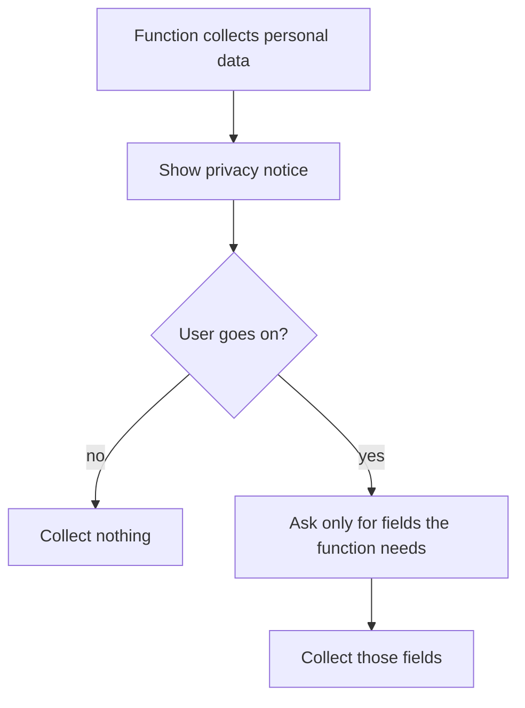

# UC-019 Be informed when personal data is collected

## Actors

- User: a person whose personal data the app would collect.
- App: the DAIY application.

## Precondition

A function of the app is about to collect personal data from the user, for example when an account is created (UC-018).

## Main flow

1. The app shows the privacy notice before it collects the data.
2. The notice states the identity and contact details of the controller, the purposes and the legal basis of the processing, the recipients, the storage period and the data protection rights of the user.
3. The user reads the notice and goes on.
4. The app asks for the data fields that the function needs.
5. The app collects only those fields.

The app collects no personal data that no function needs.

## Alternative flows

- A1, notice already seen: the user has seen the notice. The app keeps it available and shows it again when a new kind of data is collected.
- A2, user declines: the user does not go on. The app collects nothing and the user keeps using the app without that function.
- A3, optional field: a field is not needed for the function. The app does not ask for it.
- A4, recipient or purpose changes: the app shows the changed notice before it collects data under it.

## Postcondition

The user was informed of all items of the notice before data was collected. Every collected field is needed for a function.

## Diagram

