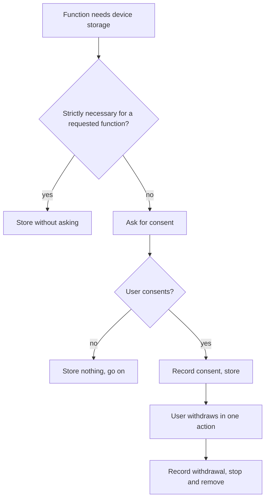

# UC-020 Give and withdraw consent

## Actors

- User: the person who decides what the app may store on the device.
- App: the DAIY application.

## Precondition

A function would store information on the device or read it from there, and that is not strictly necessary for a function the user explicitly requested.

## Main flow

1. The app asks for the user's consent for this one kind of storage or access and says what it is for.
2. The user gives the consent in one action.
3. The app records the consent and stores or reads the information.
4. Later the user opens the consent settings and sees each consent given.
5. The user withdraws a consent in one action.
6. The app records the withdrawal and stops storing and reading under that consent. It removes what it stored under it.

Withdrawing takes no more steps than giving.

## Alternative flows

- A1, strictly necessary storage: the storage is strictly necessary for a function the user explicitly requested, for example the inventory the user fills or the profile the user sets. The app stores it without asking for consent.
- A2, consent refused: the user refuses. The app stores and reads nothing under it and goes on without that function.
- A3, consent given again: after a withdrawal the user gives the consent again by the same single action.
- A4, consent list: every item the app stores on the device is either strictly necessary for a requested function or covered by a recorded consent.

## Postcondition

The app stores on the device or reads from it only what is strictly necessary for a requested function or what a recorded consent covers. A withdrawn consent is recorded and no longer used.

## Diagram

