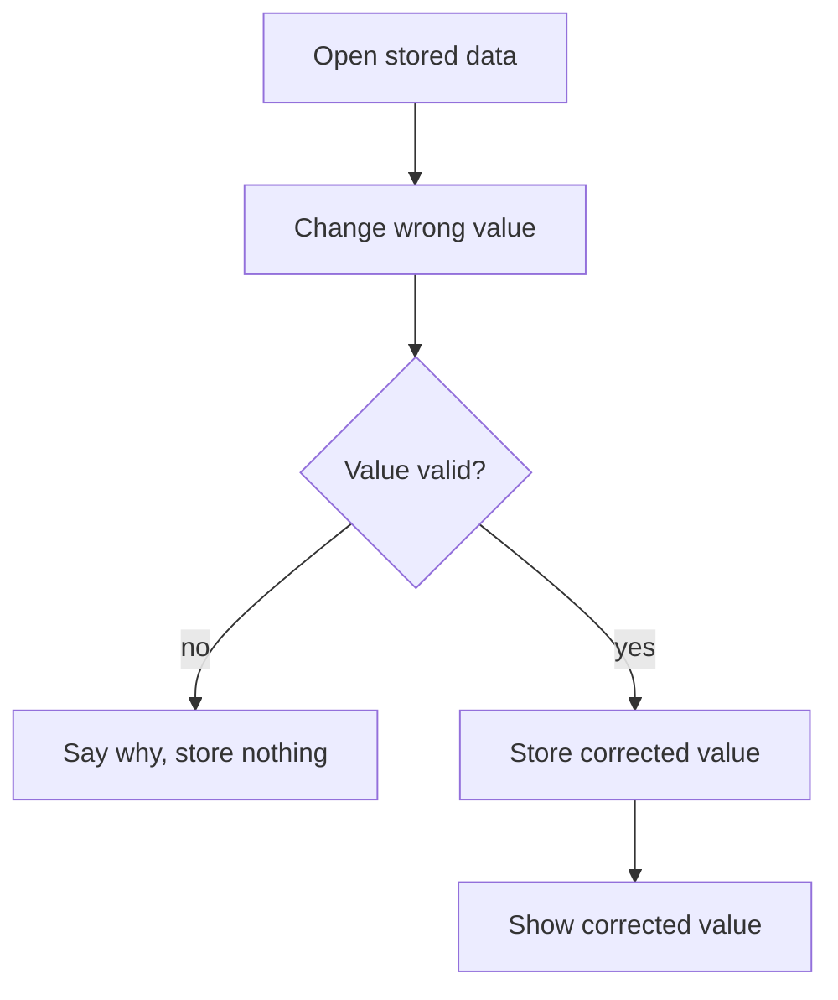

# UC-021 Correct stored personal data

## Actors

- User: the person whose data is stored.
- App: the DAIY application.

## Precondition

The app stores personal data of the user: skill profile, inventory, history, or account data.

## Main flow

1. The user opens the stored data of one kind.
2. The user changes a value that is wrong.
3. The app stores the corrected value in place of the old one.
4. The app shows the corrected value.
5. The user corrects further values or other kinds of data in the same way.

This holds for each kind of stored personal data: profile (UC-013), inventory (UC-014), history (UC-016) and account data (UC-018).

## Alternative flows

- A1, account: the user has an account. The correction reaches the account and the other devices through the sync.
- A2, invalid value: the value is not valid for its field. The app does not store it and says why.
- A3, nothing stored: no data of that kind exists. The app shows that nothing is stored.

## Postcondition

The corrected values are stored and shown. The old values no longer remain.

## Diagram

