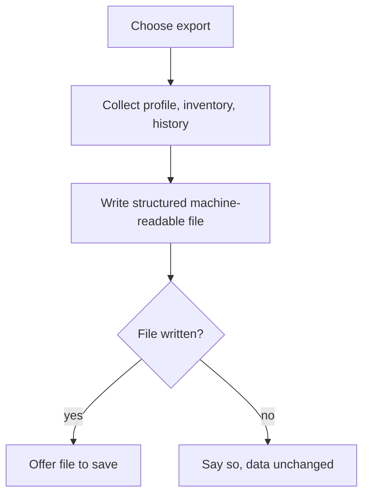

# UC-022 Export my data

## Actors

- User: the person who wants a copy of the data they provided.
- App: the DAIY application.

## Precondition

The app is open. The user may have no account.

## Main flow

1. The user chooses to export their data.
2. The app collects the data the user provided: profile, inventory and history.
3. The app writes it into one file in a structured, commonly used and machine-readable format that common tools can open.
4. The app offers the file to the user to save.
5. The user saves the file.

## Alternative flows

- A1, account: the user has an account. The export contains the account data as well.
- A2, no data: nothing is stored. The app says so and writes a file with empty sections.
- A3, export fails: the file cannot be written. The app says so and the stored data stays as it was.

## Postcondition

The user holds a file with profile, inventory and history in a structured, machine-readable format. The stored data is unchanged.

## Diagram

