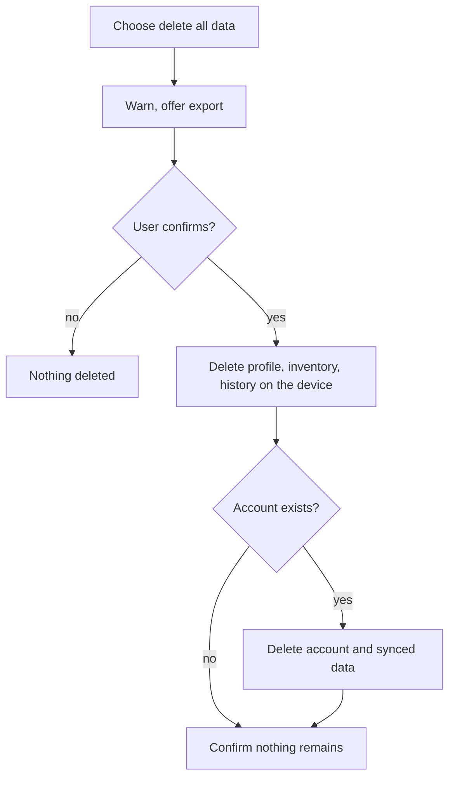

# UC-023 Delete all my data

## Actors

- User: the person who wants no data of theirs kept.
- App: the DAIY application.
- Account service: the part that stores the account and the synced data, where an account exists.

## Precondition

The app is open and stores data of the user.

## Main flow

1. The user chooses to delete all their data.
2. The app says what will be deleted and that it cannot be undone, and offers an export first (UC-022).
3. The user confirms.
4. The app deletes profile, inventory and history from the device.
5. The app deletes the stored consents and every other item it stored on the device.
6. The app confirms that no data remains.

## Alternative flows

- A1, account: the user has an account. The app also deletes the account and its synced data from the Account service, and signs the user out on every device.
- A2, cancelled: the user does not confirm. Nothing is deleted.
- A3, no data: nothing is stored. The app says so.
- A4, deletion fails: the account data cannot be deleted. The app says so and what remains, and does not claim that all data is deleted.

## Postcondition

No profile, inventory, history or account data remains on the device or in the account.

## Diagram

