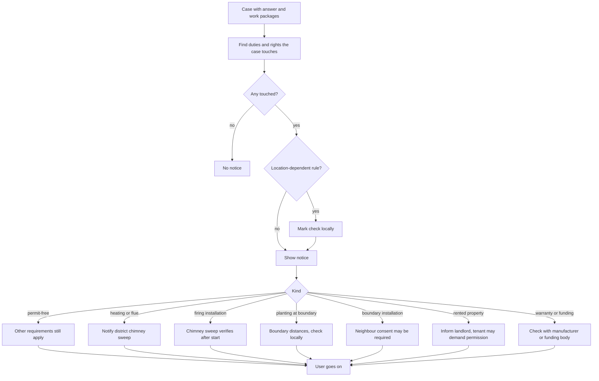

# UC-024 Be pointed to legal duties and third-party rights of a case

## Actors

- User: the person whose case touches a legal duty, a neighbour, a landlord, a chimney sweep, a warranty or a funding.
- App: the DAIY application.
- AI: the AI component that recognises which of these the case touches.
- Chimney sweep: the district chimney sweep whom the owner has to notify. The Chimney sweep does not use the app.

## Precondition

A case has been started (UC-001) and has not been escalated (UC-011). The app shows the user the answer of the case (UC-003) and its work packages (UC-010).

## Main flow

1. The app finds which of the following the case touches: a rule that depends on location, a project that needs no building permit, a heating appliance or flue system, a firing installation, planting near a property boundary, a wall, hedge, fence or other installation between two properties, rented property, or the warranty of a device or a funding.
2. The app shows a notice for each of them beside the instructions. A notice points out the duty or right. It does not decide the case for the user.
3. A rule that depends on location is never stated as fact. The app marks it "check locally".
4. For a project that needs no building permit, the app does not present the exemption as an exemption from other legal requirements. It points out that other requirements still apply.
5. For a heating appliance or flue system that must be swept or inspected, the app points out that the owner must notify the district chimney sweep when the case installs, changes or puts it back into operation, and when the case permanently takes it out of operation.
6. For a firing installation that the case installs, substantially changes or switches to another fuel, the app points out that a chimney sweep must verify after it is put into operation that it meets its requirements.
7. For trees, shrubs or hedges planted near a property boundary, the app points out that boundary distances apply, marked "check locally".
8. For a wall, hedge, fence or other installation that separates two properties and that the case removes or changes, the app points out that the neighbour's consent may be required.
9. For rented property, the app points out that the landlord should be informed.
10. For a tenant's project that is a structural change for use by people with disabilities, charging electric vehicles, burglary protection or plug-in solar devices, the app points out that the tenant can demand the landlord's permission.
11. For work that may affect the warranty of a device or a funding, the app marks the possible effect "check with manufacturer or funding body".
12. The user reads the notices and goes on with the case.

## Alternative flows

- A1, no notice applies: the case touches none of these. The app shows no notice.
- A2, several notices: more than one applies. The app shows each one separately.
- A3, uncertain: the app cannot tell whether a notice applies. It shows the notice, worded as a possibility, and does not state the rule as fact.
- A4, permit-free project: the project needs no building permit. No answer, summary or label presents this as freedom from other requirements, such as neighbour law, fire protection, product rules or the duties above.
- A5, notice ignored: the user does not react. The app is not blocked.
- A6, hazard or out-of-scope work: the case is escalated (UC-011). The escalation replaces the notices.

## Postcondition

Every duty or right that the case touches is pointed out. Every rule that depends on location carries the mark "check locally". No answer presents a permit-free project as free of other requirements. Possible effects on warranty or funding carry the mark "check with manufacturer or funding body".

## Diagram

