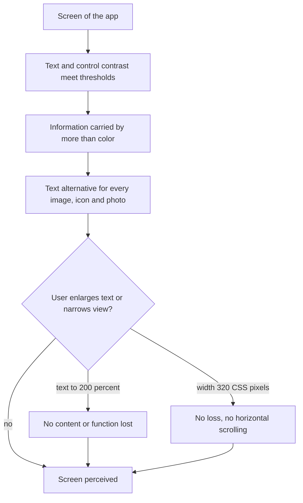

# UC-025 Perceive the content of the app

## Actors

- User: a person who uses the app, including a person who uses assistive technology, a magnified view or no color vision.
- App: the DAIY application.

## Precondition

The app is open on a screen of any step of a case. No account is required.

## Main flow

1. The user views a screen of the app.
2. The app shows text that is not large-scale with a contrast ratio of at least 4.5:1 against its background, and large-scale text with at least 3:1.
3. The app shows the boundaries and state indicators of controls with a contrast ratio of at least 3:1 against adjacent colors.
4. The app conveys no state, label or other information by color alone. A second cue such as text or a symbol is always present.
5. The app gives every image, icon and photo it shows a text alternative that serves the same purpose.
6. The user enlarges the text up to 200 percent. No content or function is lost.
7. The user views the screen at a width of 320 CSS pixels. No content or function is lost and no horizontal scrolling is needed.

This holds on every screen of the app.

## Alternative flows

- A1, grayscale: the user views the app in grayscale. All states and labels can still be told apart.
- A2, screen reader: the user reads the screen with a screen reader. Every image, icon and photo is announced with its text alternative.
- A3, user photo: the user attached a photo to a case (UC-001). The app gives it a text alternative that serves the same purpose.
- A4, decorative element: an element conveys no information. The app marks it so that assistive technology skips it.

## Postcondition

Every screen is perceivable: text and controls meet the contrast thresholds, no information depends on color alone, non-text content has a text alternative, and text at 200 percent and the view at 320 CSS pixels lose no content or function and need no horizontal scrolling.

## Diagram

