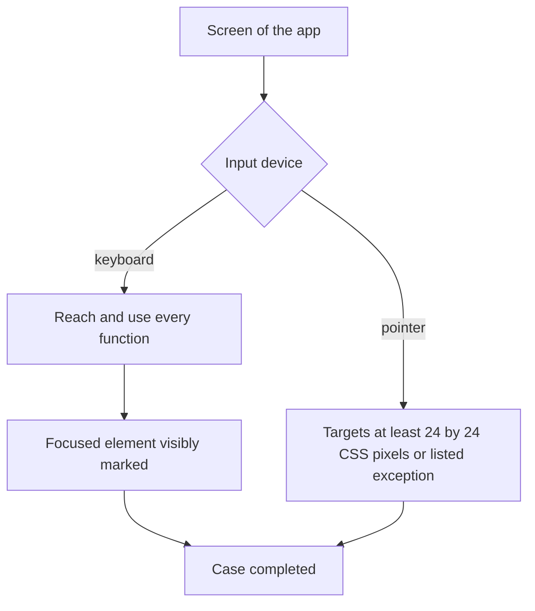

# UC-026 Operate the app by keyboard and pointer

## Actors

- User: a person who operates the app with a keyboard, a pointer or both.
- App: the DAIY application.

## Precondition

The app is open. No account is required.

## Main flow

1. The user runs a full case using only the keyboard, from starting the case to the work and the materials.
2. Every function can be reached and used through the keyboard interface.
3. While the user tabs through a screen, the app visibly marks the focused element at all times.
4. When the user uses a pointer, every pointer target is at least 24 by 24 CSS pixels, unless a WCAG 2.2 exception applies.

This holds on every screen of the app.

## Alternative flows

- A1, pointer user: the user operates the app with a pointer only. Every function can be used through targets that meet the size.
- A2, listed exception: a target is smaller than 24 by 24 CSS pixels. A WCAG 2.2 exception applies and is the only reason for the smaller size.
- A3, switch of device: the user changes between keyboard and pointer within a case. The case state is kept.

## Postcondition

A full case can be completed with the keyboard alone. The focused element is always visibly marked. Every pointer target has the minimum size or a listed exception.

## Diagram

