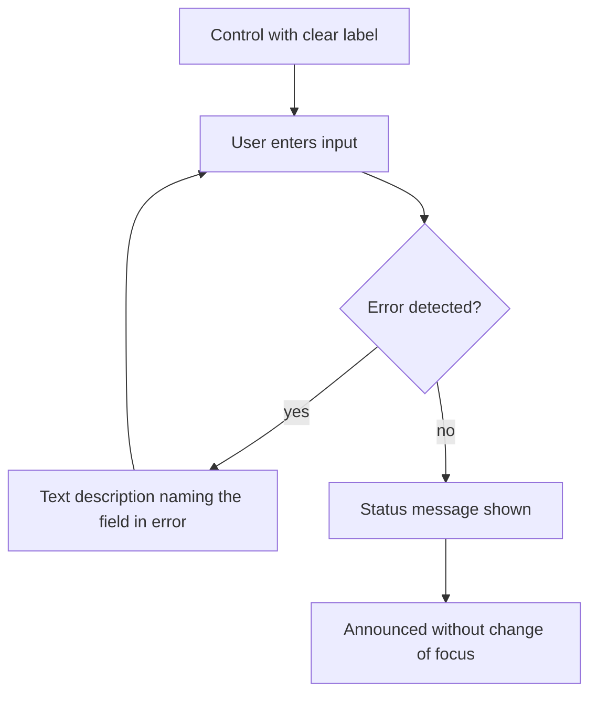

# UC-027 Enter input and be told of errors and status

## Actors

- User: a person who enters input, including a person who uses a screen reader.
- App: the DAIY application.

## Precondition

The user is on a screen with a form or a control, for example the input of UC-001, the profile of UC-013 or the inventory of UC-014.

## Main flow

1. The user sees a control. It carries a clear, descriptive label.
2. The user enters input into a field.
3. The app detects an input error automatically.
4. The app describes the error in text that names the field in error, and the user corrects it.
5. The app shows a status message, for example that an item was saved.
6. Assistive technology presents the status message without the focus moving.

This holds for every form, control and status message of the app.

## Alternative flows

- A1, several errors: more than one field is in error. The app describes each error in text and names each field.
- A2, screen reader: the user uses a screen reader. The label of each control, the text of each error and each status message are announced, and the focus stays where it was.
- A3, no error: the input is valid. The app shows no error and the case goes on.

## Postcondition

Every control has a descriptive label. Every automatically detected input error is described in text that names the field in error. Every status message is announced by assistive technology without a change of focus.

## Diagram

